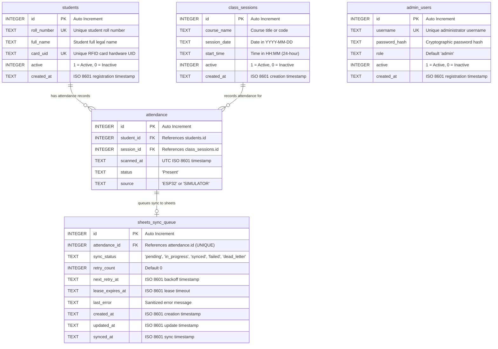

# SQLite Database Design & Architecture Documentation

**Project:** IoT-Based Smart Attendance Management System  
**Database Engine:** SQLite 3  
**Database File:** `database/attendance.db` (Development) / `database/test_attendance.db` (Testing)  
**Configuration File:** `app/config.py`  
**Schema Definition:** `app/models.py`  
**Connection Handler:** `app/database.py`  

---

## 1. Why SQLite is the Primary Database

SQLite was chosen as the authoritative persistence engine for the Smart Attendance Management System for the following architectural reasons:

1. **Local ACID Reliability:** Full atomicity, consistency, isolation, and durability guarantees ensure that attendance records are never corrupted during sudden power cuts or network drops.
2. **Zero Configuration & Self-Contained:** Stored as a single cross-platform disk file (`database/attendance.db`), requiring no standalone server daemon to install, configure, or administer.
3. **High-Performance Edge Execution:** SQLite operates in-process with Python, executing queries in microseconds with minimal RAM and CPU overhead.
4. **Offline Resilience:** If future classroom Internet connectivity fails, attendance records continue to write locally without loss, queuing records for later synchronization.
5. **Robust Integrity Protections:** Supports foreign-key cascading and partial unique indexes to physically enforce business rules at the storage layer.

---

## 2. Entity-Relationship (ER) Diagram



### ASCII Schema Representation
```text
+-----------------------+              +-----------------------+
|       students        |              |    class_sessions     |
+-----------------------+              +-----------------------+
| PK  id                |              | PK  id                |
| UK  roll_number       |              |     course_name       |
|     full_name         |              |     session_date      |
| UK  card_uid          |              |     start_time        |
|     active            |              | UK* active (WHERE 1)  |
|     created_at        |              |     created_at        |
+-----------------------+              +-----------------------+
            |                                      |
            | 1                                    | 1
            |                                      |
            |              +-------------------+   |
            +------------< |    attendance     | >-+
                         N +-------------------+ N
                           | PK  id            |
                           | FK  student_id    |
                           | FK  session_id    |
                           |     scanned_at    |
                           |     status        |
                           |     source        |
                           | UK(std_id, sess_id|
                           +-------------------+
                                     | 1
                                     |
                                     | 1 (Transactional Outbox)
                                     v
                           +------------------------+
                           |   sheets_sync_queue    |
                           +------------------------+
                           | PK  id                 |
                           | FK  attendance_id (UK) |
                           |     sync_status        |
                           |     retry_count        |
                           |     next_retry_at      |
                           |     lease_expires_at   |
                           |     last_error         |
                           |     created_at         |
                           |     updated_at         |
                           |     synced_at          |
                           +------------------------+
```

---

## 3. Table Specifications

### Table 1: `students`
Stores registered student identities and their assigned RFID card hardware UIDs.

| Column | Data Type | Constraints | Description |
| :--- | :--- | :--- | :--- |
| `id` | `INTEGER` | `PRIMARY KEY AUTOINCREMENT` | Surrogate primary key. |
| `roll_number` | `TEXT` | `NOT NULL UNIQUE` | Unique student roll number (e.g. `"101"`, `"CS-202"`). |
| `full_name` | `TEXT` | `NOT NULL` | Student full legal name (e.g. `"Rahul Sharma"`). |
| `card_uid` | `TEXT` | `NOT NULL UNIQUE` | Normalized uppercase RFID UID (e.g. `"A1B2C3D4"`). |
| `active` | `INTEGER` | `NOT NULL DEFAULT 1` | Account status (`1` = Active, `0` = Inactive/Withdrawn). |
| `created_at` | `TEXT` | `NOT NULL` | Registration timestamp in ISO 8601 UTC format. |

#### DDL Statement
```sql
CREATE TABLE IF NOT EXISTS students (
    id INTEGER PRIMARY KEY AUTOINCREMENT,
    roll_number TEXT NOT NULL UNIQUE,
    full_name TEXT NOT NULL,
    card_uid TEXT NOT NULL UNIQUE,
    active INTEGER NOT NULL DEFAULT 1,
    created_at TEXT NOT NULL
);
```

---

### Table 2: `class_sessions`
Represents scheduled classroom lectures or laboratory sessions.

| Column | Data Type | Constraints | Description |
| :--- | :--- | :--- | :--- |
| `id` | `INTEGER` | `PRIMARY KEY AUTOINCREMENT` | Surrogate primary key. |
| `course_name` | `TEXT` | `NOT NULL` | Course title or subject code (e.g. `"CS101"`). |
| `session_date` | `TEXT` | `NOT NULL` | Session date in `YYYY-MM-DD` format. |
| `start_time` | `TEXT` | `NOT NULL` | Scheduled start time in 24-hour `HH:MM` format. |
| `active` | `INTEGER` | `NOT NULL DEFAULT 0` | Session state (`1` = Active, `0` = Inactive). |
| `created_at` | `TEXT` | `NOT NULL` | Creation timestamp in ISO 8601 UTC format. |

#### DDL Statement
```sql
CREATE TABLE IF NOT EXISTS class_sessions (
    id INTEGER PRIMARY KEY AUTOINCREMENT,
    course_name TEXT NOT NULL,
    session_date TEXT NOT NULL,
    start_time TEXT NOT NULL,
    active INTEGER NOT NULL DEFAULT 0,
    created_at TEXT NOT NULL
);
```

---

### Table 3: `attendance`
Records validated card tap events linking a student to a class session.

| Column | Data Type | Constraints | Description |
| :--- | :--- | :--- | :--- |
| `id` | `INTEGER` | `PRIMARY KEY AUTOINCREMENT` | Surrogate primary key. |
| `student_id` | `INTEGER` | `NOT NULL, FK -> students(id)` | Foreign key referencing the student. |
| `session_id` | `INTEGER` | `NOT NULL, FK -> class_sessions(id)` | Foreign key referencing the class session. |
| `scanned_at` | `TEXT` | `NOT NULL` | Server-generated official UTC timestamp. |
| `status` | `TEXT` | `NOT NULL DEFAULT 'Present'` | Attendance status recorded (default: `'Present'`). |
| `source` | `TEXT` | `NOT NULL` | Scanning device identifier (e.g. `'ESP32'`, `'SIMULATOR'`). |

#### Composite Unique Constraint
```sql
CONSTRAINT uq_student_session UNIQUE (student_id, session_id)
```
Guarantees that a student can only have **one** attendance record per session. Any second attempt raises an `IntegrityError` at the database engine level.

#### DDL Statement
```sql
CREATE TABLE IF NOT EXISTS attendance (
    id INTEGER PRIMARY KEY AUTOINCREMENT,
    student_id INTEGER NOT NULL,
    session_id INTEGER NOT NULL,
    scanned_at TEXT NOT NULL,
    status TEXT NOT NULL DEFAULT 'Present',
    source TEXT NOT NULL,
    FOREIGN KEY (student_id) REFERENCES students(id) ON DELETE RESTRICT,
    FOREIGN KEY (session_id) REFERENCES class_sessions(id) ON DELETE RESTRICT,
    UNIQUE (student_id, session_id)
);
```

---

### Table 4: `admin_users`
Stores authenticated administrator accounts with secure hashed passwords for role-based system access.

| Column | Data Type | Constraints | Description |
| :--- | :--- | :--- | :--- |
| `id` | `INTEGER` | `PRIMARY KEY AUTOINCREMENT` | Surrogate primary key. |
| `username` | `TEXT` | `NOT NULL UNIQUE` | Unique administrator username (e.g. `"admin"`). |
| `password_hash` | `TEXT` | `NOT NULL` | Werkzeug scrypt/pbkdf2 salted cryptographic hash. Never plaintext. |
| `role` | `TEXT` | `NOT NULL DEFAULT 'admin'` | System authorization role. |
| `active` | `INTEGER` | `NOT NULL DEFAULT 1` | Account state (`1` = Active, `0` = Deactivated). |
| `created_at` | `TEXT` | `NOT NULL` | Registration timestamp in ISO 8601 UTC format. |

#### DDL Statement
```sql
CREATE TABLE IF NOT EXISTS admin_users (
    id INTEGER PRIMARY KEY AUTOINCREMENT,
    username TEXT NOT NULL UNIQUE,
    password_hash TEXT NOT NULL,
    role TEXT NOT NULL DEFAULT 'admin',
    active INTEGER NOT NULL DEFAULT 1,
    created_at TEXT NOT NULL
);
```

---

### Table 5: `sheets_sync_queue`
Stores local outbox records for asynchronous, reliable synchronization to Google Sheets. Implements the Transactional Outbox Pattern to decouple physical RFID scanning from external cloud network latency.

| Column | Data Type | Constraints | Description |
| :--- | :--- | :--- | :--- |
| `id` | `INTEGER` | `PRIMARY KEY AUTOINCREMENT` | Surrogate primary key. |
| `attendance_id` | `INTEGER` | `NOT NULL UNIQUE, FK -> attendance(id)` | Foreign key to `attendance.id`. Cascades on deletion. |
| `sync_status` | `TEXT` | `NOT NULL DEFAULT 'pending'` | Synchronization status (`pending`, `in_progress`, `synced`, `failed`, `dead_letter`). |
| `retry_count` | `INTEGER` | `NOT NULL DEFAULT 0` | Cumulative number of failed synchronization attempts. |
| `next_retry_at` | `TEXT` | `NULLABLE` | ISO 8601 UTC timestamp for exponential backoff scheduling. |
| `lease_expires_at` | `TEXT` | `NULLABLE` | ISO 8601 UTC lease timeout preventing worker overlap. |
| `last_error` | `TEXT` | `NULLABLE` | Sanitized error or exception description (truncated to 500 chars). |
| `created_at` | `TEXT` | `NOT NULL` | Creation timestamp in ISO 8601 UTC format. |
| `updated_at` | `TEXT` | `NOT NULL` | Last status modification timestamp in ISO 8601 UTC format. |
| `synced_at` | `TEXT` | `NULLABLE` | ISO 8601 UTC timestamp when Google Sheets returned HTTP 200 OK. |

#### DDL Statement
```sql
CREATE TABLE IF NOT EXISTS sheets_sync_queue (
    id INTEGER PRIMARY KEY AUTOINCREMENT,
    attendance_id INTEGER NOT NULL UNIQUE,
    sync_status TEXT NOT NULL DEFAULT 'pending' CHECK (sync_status IN ('pending', 'in_progress', 'synced', 'failed', 'dead_letter')),
    retry_count INTEGER NOT NULL DEFAULT 0,
    next_retry_at TEXT,
    lease_expires_at TEXT,
    last_error TEXT,
    created_at TEXT NOT NULL,
    updated_at TEXT NOT NULL,
    synced_at TEXT,
    FOREIGN KEY (attendance_id) REFERENCES attendance(id) ON DELETE CASCADE
);
```

#### Synchronization Queue Lifecycle & State Machine
The `sheets_sync_queue` table enforces a strict finite state machine:
- **`pending`**: Initial state inserted atomically in the same database transaction as the `attendance` row. Ready for worker claiming.
- **`in_progress`**: Claimed by a sync worker process with a 60-second lease timestamp (`lease_expires_at`). Concurrently running workers skip records in this state. If a worker process crashes mid-sync, the lease expires and the record is automatically reclaimed by the next worker run.
- **`synced`**: Terminal success state. The attendance row has been safely appended to the external Google Sheet, and Google Sheets API returned HTTP 200. `synced_at` records the exact UTC completion time.
- **`failed`**: Transient error state (e.g. rate limit HTTP 429, backend HTTP 500/503, network timeout). The worker records `last_error`, increments `retry_count`, and schedules `next_retry_at` using full exponential backoff with jitter (`2s`, `4s`, `8s`, `16s`, `32s` ... max `300s`). When `datetime.now(timezone.utc) >= next_retry_at`, the record transitions back to `pending`.
- **`dead_letter`**: Terminal failure state. Records enter dead-letter status when either:
  1. The maximum retry threshold (`MAX_RETRY_ATTEMPTS = 5`) is exhausted.
  2. An unrecoverable permanent error is encountered (HTTP 401 Unauthorized, HTTP 403 Forbidden, HTTP 404 Spreadsheet Not Found, missing service account file, or missing spreadsheet ID). Permanent errors bypass further automatic retries to protect upstream API quota and prevent log flooding.
  
  Administrators can inspect dead-letter records via `GET /api/admin/sheets-sync/dead-letter` and requeue them via `POST /api/admin/sheets-sync/dead-letter/retry`.

---

## 4. Database-Level Business Rule Enforcements

### 1. Single Active Class Session Enforcement
To prevent cross-class confusion, only **one** class session may be active in the system at any given moment. This rule is physically protected at the database engine level using a **partial unique index**:

```sql
CREATE UNIQUE INDEX IF NOT EXISTS idx_single_active_session 
ON class_sessions(active) 
WHERE active = 1;
```

#### How it works:
- If session 1 has `active = 1`, the index stores `(1)`.
- If an application bug or concurrent query attempts to set session 2 to `active = 1` without deactivating session 1, SQLite detects that the value `1` already exists in `idx_single_active_session` and raises `sqlite3.IntegrityError: UNIQUE constraint failed`.
- Inactive sessions (`active = 0`) are ignored by the `WHERE active = 1` clause, permitting unlimited inactive sessions.

### 2. Duplicate Attendance Prevention
Physical duplicate prevention is achieved via:
```sql
UNIQUE (student_id, session_id)
```
If two scan requests arrive concurrently for the same student in the same session, SQLite enforces serial execution. The first transaction succeeds, while the second triggers an integrity constraint failure and is rolled back.

### 3. Foreign Key Enforcement
By default in SQLite, foreign key constraints are disabled. The application explicitly enables foreign keys on every connection in `app/database.py`:
```python
conn.execute("PRAGMA foreign_keys = ON;")
```
This prevents orphaned attendance records referencing non-existent students or sessions.

---

## 5. Performance Indexes

The following indexes optimize lookup speeds as data grows:

```sql
-- Fast administrator lookup during login
CREATE INDEX IF NOT EXISTS idx_admin_users_username ON admin_users(username);

-- Fast student lookup by roll number
CREATE INDEX IF NOT EXISTS idx_students_roll_number ON students(roll_number);

-- Instant student lookup when RFID card is tapped
CREATE INDEX IF NOT EXISTS idx_students_card_uid ON students(card_uid);

-- Fast active class session lookup
CREATE INDEX IF NOT EXISTS idx_sessions_active ON class_sessions(active);

-- Fast session filtering for daily attendance reports
CREATE INDEX IF NOT EXISTS idx_sessions_date ON class_sessions(session_date);

-- Fast duplicate scan checks
CREATE INDEX IF NOT EXISTS idx_attendance_student_session ON attendance(student_id, session_id);

-- Fast attendance history queries by student
CREATE INDEX IF NOT EXISTS idx_attendance_student ON attendance(student_id);

-- Fast attendance history queries by session
CREATE INDEX IF NOT EXISTS idx_attendance_session ON attendance(session_id);

-- Fast attendance queries by scan timestamp
CREATE INDEX IF NOT EXISTS idx_attendance_scanned_at ON attendance(scanned_at);

-- Fast polling for pending and retry-eligible synchronization records
CREATE INDEX IF NOT EXISTS idx_sync_queue_status_retry ON sheets_sync_queue(sync_status, next_retry_at);

-- Fast lookup of sync status by attendance_id
CREATE INDEX IF NOT EXISTS idx_sync_queue_attendance_id ON sheets_sync_queue(attendance_id);

-- Fast recovery of expired worker processing leases
CREATE INDEX IF NOT EXISTS idx_sync_queue_lease ON sheets_sync_queue(sync_status, lease_expires_at);
```

---

## 6. Timestamp Strategy & Timezone Handling

### Authoritative Server UTC Timestamps
All timestamps stored in the database (`students.created_at`, `class_sessions.created_at`, `attendance.scanned_at`) are generated strictly by the backend server using UTC:
```python
datetime.now(timezone.utc).strftime("%Y-%m-%dT%H:%M:%SZ")
```
- Example stored value: `2026-11-07T10:05:00Z`
- **Why UTC?** Avoids daylight saving time glitches, clock drift between client hardware, and localized server time ambiguities.

### Local Reporting Timezone
Configured in `app/config.py`:
```python
DEFAULT_TIMEZONE = os.environ.get("DEFAULT_TIMEZONE", "Asia/Kolkata")
```
Daily reports and CSV filenames (`attendance_YYYY-MM-DD.csv`) are indexed by local college operating dates (`session_date` in `YYYY-MM-DD`), providing localized reporting while preserving UTC audit trails.
