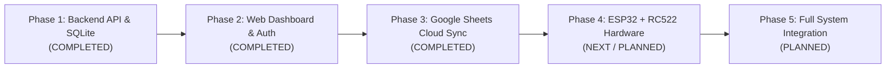

# Future Development Roadmap

**Project:** IoT-Based Smart Attendance Management System  
**Overall Goal:** Build a complete end-to-end college project spanning firmware, backend APIs, modern web dashboard, and cloud spreadsheet synchronization.

---

## Phase Overview

---

## Phase 1: Backend Development (Python + Flask + SQLite)
**Status:** **COMPLETE**

### Completed Milestones
- **Milestone 1:** Virtual Environment & Dependency Management (`Flask`, `requests`, `pytest`, `pytest-cov`).
- **Milestone 2:** SQLite Database Design (`students`, `class_sessions`, `attendance` with `idx_single_active_session` and foreign keys).
- **Milestone 3:** Flask Application Factory, Health Check API (`GET /api/health`), and JSON error handlers.
- **Milestone 4:** Student Registration and Retrieval API (`POST /api/students`, `GET /api/students`).
- **Milestone 5:** Class Session Management API (`POST`, `GET`, `GET /active`, `PATCH /activate`, `PATCH /deactivate`).
- **Milestone 6:** RFID Attendance Scan & 6-Stage Validation API (`POST /api/scans`).
- **Milestone 7:** Attendance Reports & Sanitized CSV Export API (`GET /api/reports/daily`, `GET /api/reports/export.csv`).
- **Milestone 8:** Python-based Simulated RFID Scanner (`scripts/simulate_scan.py`).
- **Milestone 9:** System-Wide Reliability Audit, End-to-End Workflows, and 91% Code Coverage Verification (167 passing tests).
- **Milestone 10:** Comprehensive Documentation and Project Wrap-up.

---

## Phase 2: Web Dashboard & Administrative Security (HTML5, CSS3, JS, Bootstrap)
**Status:** **COMPLETE**

### Completed Milestones
- **Milestone 1:** Dashboard Architecture & Layout Template (`templates/layout.html`, Bootstrap 5.3, responsive navbar, dark mode toggle).
- **Milestone 2:** Student Registration & Management UI (`templates/students.html`, live validation, modal forms, active toggles).
- **Milestone 3:** Class Session Management UI (`templates/sessions.html`, session creator, one-click activation/deactivation).
- **Milestone 4:** Live Classroom Attendance Feed & RFID Simulator (`templates/live.html`, polling feed, browser-based scan simulator).
- **Milestone 5:** Daily Attendance Reports & CSV Export UI (`templates/reports.html`, date picker, statistics summary, sanitized export button).
- **Milestone 6:** System Maintenance, Statistics & Database Backup UI (`templates/admin.html`, live record counts, verified ACID backup before clear).
- **Milestone 7:** Administrator Authentication, Scrypt Password Hashing, Session Security & CSRF Protection (`templates/login.html`, `flask create-admin`, session cookies).
- **Milestone 8:** Comprehensive Phase 2 Integration Audit & Reliability Verification (289 passing tests, 93% coverage).

---

## Phase 3: Google Sheets Cloud Synchronization & Outbox Reliability
**Status:** **COMPLETE**

### Completed Milestones
- **Milestone 1:** Google Sheets Architectural Blueprint & 10-Column Data Contract (`app/services/google_sheets.py`, formulas sanitization, Asia/Kolkata date/time mapping).
- **Milestone 2:** SQLite Transactional Outbox Pattern (`sheets_sync_queue` table, atomic dual-write alongside attendance scan, idempotent status tracking).
- **Milestone 3:** Google Cloud Service Account Integration & `.gitignore` Credential Security (`credentials/` protection, environment-based configuration).
- **Milestone 4:** Background Sync Worker Daemon & Single-Pass CLI (`flask run-sheets-worker` and `--once`, lease acquisition & automatic recovery).
- **Milestone 5:** Exponential Retry Backoff, Duplicate Prevention & Dead-Letter Queue API (`GET /api/admin/sheets-sync/status`, `GET /api/admin/sheets-sync/dead-letter`, `POST /api/admin/sheets-sync/dead-letter/retry`).
- **Milestone 6:** End-to-End Integration Testing, Documentation Synchronization & Final Reliability Audit (432 passing tests, 0 failures, 1 upstream warning).

---

## Phase 4: Physical Hardware Integration (ESP32 + RC522)
**Status:** **NEXT / PLANNED**

Phase 4 replaces the software simulator (`scripts/simulate_scan.py`) with physical embedded IoT hardware mounted at classroom entrances.

### Hardware Components
1. **ESP32 DevKit V1 (30-pin / 38-pin):** Dual-core 240 MHz microcontroller with built-in 2.4 GHz Wi-Fi.
2. **RC522 RFID Reader Module:** 13.56 MHz contactless reader module communicating over SPI protocol.
3. **Mifare Classic 1K RFID Cards / Keyfobs:** Unique 4-byte or 7-byte hardware UIDs.
4. **Status Indicators:**
   - Green LED: Scan Accepted (HTTP 201).
   - Red LED: Scan Rejected (HTTP 409 Duplicate / 404 Unknown).
   - Piezo Buzzer: Audio beep confirmation.

### Hardware Wiring Warning
> [!WARNING]
> **RC522 OPERATES AT 3.3V ONLY.** Connecting the RC522 `VCC` pin to the ESP32 `5V` (VIN) rail will permanently burn out the RFID reader chip. Always connect `VCC` strictly to the ESP32 `3V3` pin.

### ESP32 Pinout Mapping (Standard VSPI)
| RC522 Pin | ESP32 Pin | Function |
| :--- | :--- | :--- |
| **VCC** | **3V3** | **Power Supply (3.3V ONLY - DO NOT USE 5V)** |
| **RST** | **GPIO 22** | Module Reset |
| **GND** | **GND** | Ground Reference |
| **MISO** | **GPIO 19** | SPI Master In / Slave Out |
| **MOSI** | **GPIO 23** | SPI Master Out / Slave In |
| **SCK** | **GPIO 18** | SPI Clock |
| **SDA (SS)** | **GPIO 5** | SPI Slave Select |

### Firmware Architecture (C++ / Arduino IDE)
1. Initialize Wi-Fi connection with auto-reconnect logic.
2. Poll RC522 reader for new card arrival (`PICC_IsNewCardPresent()`).
3. Read card UID and convert to uppercase hexadecimal string.
4. Construct JSON payload: `{"card_uid": "A1B2C3D4", "source": "ESP32"}`.
5. Send HTTP POST to `http://<server-ip>:5000/api/scans`.
6. Parse HTTP status code:
   - `201`: Turn on Green LED for 800ms, single short beep.
   - `409` or `404`: Turn on Red LED for 1200ms, double short beep.

---

## Phase 5: Full System Integration & Project Demonstration
**Status:** **PLANNED**

The final phase unifies all hardware, software, and cloud components into an end-to-end demonstration package:

1. **Integrated Live Testing:**
   - Powering the ESP32 via wall adapter.
   - Tapping physical RFID cards.
   - Observing instantaneous attendance appearance on the web dashboard.
   - Automatic row insertion in Google Sheets via n8n.
2. **Fault-Tolerance & Edge Recovery Testing:**
   - Simulating Wi-Fi dropouts during class scanning.
   - Testing server restart recovery.
3. **College Project Deliverables:**
   - Comprehensive Project Report (Literature survey, system design, circuit schematics, API contracts, test results).
   - PowerPoint Presentation (Architecture diagrams, demonstration video).
   - Circuit diagrams (Fritzing schematics).
   - Final academic project defense demonstration.
