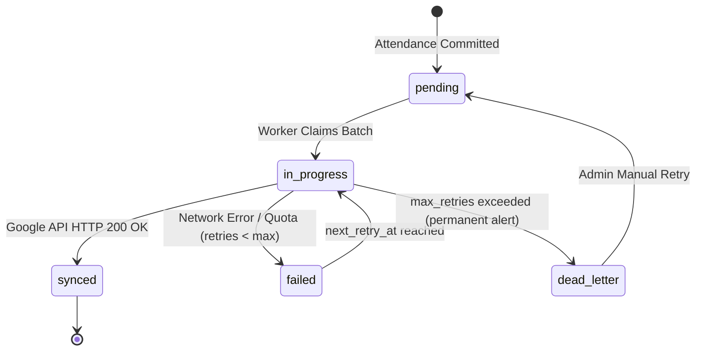
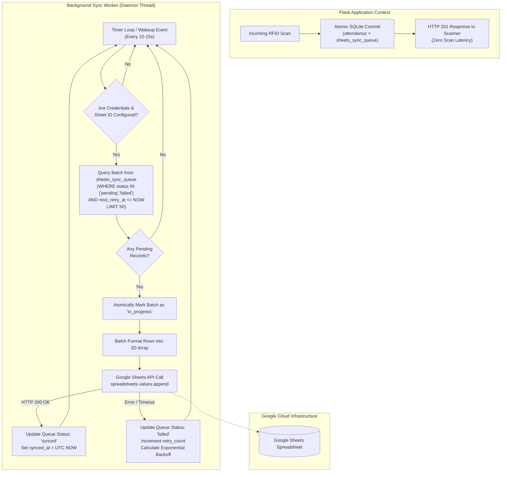
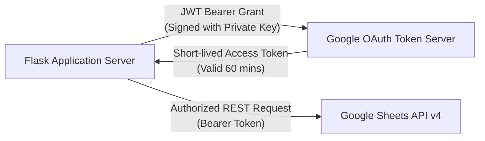
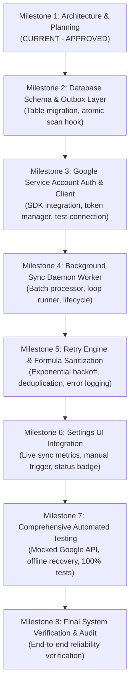

# Phase 3 — Milestone 1: Google Sheets Integration Architecture & Planning Report

**Project:** IoT-Based Smart Attendance Management System  
**Phase:** Phase 3 — Cloud Synchronization & External Integration  
**Milestone:** Milestone 1 — Google Sheets Integration Architecture & Planning  
**Workspace:** `C:\Users\niraj\Downloads\Smart-Attendance-System`  
**Current Baseline:** 330 automated tests passing (100% pass rate)  
**Date:** November 2026  
**Status:** Complete & Awaiting Phase 3 Milestone 2 Approval  

---

## Executive Summary

Phase 1 (Backend APIs, Database Design, RFID Scan Engine, CSV Reporting) and Phase 2 (Responsive Web Dashboard, Live Monitoring, Administrator Authentication, CSRF Security, Session Auto-Deactivation, and Database Management) are fully completed, approved, and verified with 330 passing automated tests.

Phase 3 introduces automated, cloud-based synchronization of verified student attendance records to **Google Sheets**. In accordance with core system requirements:
- **SQLite remains the single authoritative, primary database.**
- **Google Sheets is an external reporting and administrative destination only**, never a replacement for SQLite.
- Attendance records must **never be lost or delayed** due to network latency, Wi-Fi outages, Google Cloud rate limits, or expired credentials.
- The system adopts a battle-tested **Transactional Outbox Pattern** to decouple physical RFID scanning from external cloud network calls.

This report establishes the complete architectural specification, schema additions, synchronization workflow, failure recovery algorithms, security policies, and phased implementation roadmap.

---

## 1. Existing Architecture Assessment

### 1.1 Technology Stack & Runtime Environment
- **Operating System:** Windows 11
- **Python Runtime:** Python 3.10.11
- **Web Application Framework:** Flask 3.1.3 (Application Factory pattern in `app/__init__.py:create_app`)
- **Primary Database:** SQLite 3 (ACID-compliant relational engine stored at `database/attendance.db`)
- **Frontend Architecture:** HTML5, CSS3, Vanilla JavaScript (ES6+ modular framework)
- **Background Task Management:** Daemon thread singleton (`SessionExpiryScheduler` in `app/scheduler.py`)
- **Security & Authorization:** Session-based authentication, scrypt password hashing, double-submit CSRF protection (`X-CSRF-Token`), client IP rate limiting.
- **Automated Test Suite:** `pytest 9.2.0` with `pytest-cov 7.1.0` (330 tests covering all functional and security layers).

### 1.2 Current Database Schema Analysis
Inspection of `app/models.py` and `app/database.py` reveals 4 production tables:

```text
+-----------------------------------------------------------------------------------+
|                                    STUDENTS                                       |
+-----------------------------------------------------------------------------------+
| id (INTEGER PK AUTO)                                                              |
| roll_number (TEXT UNIQUE)                                                          |
| full_name (TEXT)                                                                  |
| card_uid (TEXT UNIQUE)                                                            |
| active (INTEGER NOT NULL DEFAULT 1)                                               |
| created_at (TEXT ISO 8601 UTC)                                                    |
+-----------------------------------------------------------------------------------+
                                        | 1
                                        |
                                        | N
+---------------------------------------v-------------------------------------------+
|                                  ATTENDANCE                                       |
+-----------------------------------------------------------------------------------+
| id (INTEGER PK AUTO)                                                              |
| student_id (INTEGER FK -> students.id ON DELETE CASCADE)                          |
| session_id (INTEGER FK -> class_sessions.id ON DELETE CASCADE)                   |
| scanned_at (TEXT NOT NULL ISO 8601 UTC 'YYYY-MM-DDTHH:MM:SSZ')                    |
| status (TEXT NOT NULL DEFAULT 'Present')                                          |
| source (TEXT NOT NULL)                                                            |
| UNIQUE(student_id, session_id)                                                    |
+-----------------------------------------------------------------------------------+
                                        ^ N
                                        |
                                        | 1
+---------------------------------------+-------------------------------------------+
|                               CLASS_SESSIONS                                      |
+-----------------------------------------------------------------------------------+
| id (INTEGER PK AUTO)                                                              |
| course_name (TEXT NOT NULL)                                                       |
| session_date (TEXT NOT NULL 'YYYY-MM-DD')                                         |
| start_time (TEXT NOT NULL 'HH:MM')                                                |
| end_time (TEXT 'HH:MM')                                                           |
| active (INTEGER NOT NULL DEFAULT 0)                                               |
| created_at (TEXT NOT NULL ISO 8601 UTC)                                           |
| UNIQUE INDEX: idx_single_active_session ON class_sessions(active) WHERE active = 1  |
+-----------------------------------------------------------------------------------+

+-----------------------------------------------------------------------------------+
|                                  ADMIN_USERS                                      |
+-----------------------------------------------------------------------------------+
| id (INTEGER PK AUTO)                                                              |
| username (TEXT NOT NULL UNIQUE)                                                   |
| password_hash (TEXT NOT NULL)                                                     |
| role (TEXT NOT NULL DEFAULT 'admin')                                              |
| active (INTEGER NOT NULL DEFAULT 1)                                               |
| created_at (TEXT NOT NULL ISO 8601 UTC)                                           |
+-----------------------------------------------------------------------------------+
```

### 1.3 Key Architectural Strengths
1. **Database-Enforced Integrity:** Foreign key cascading (`PRAGMA foreign_keys = ON;`), duplicate attendance prevention (`UNIQUE(student_id, session_id)`), and single-active-session partial index (`WHERE active = 1`).
2. **Deterministic Locking:** State modifications use `BEGIN IMMEDIATE;` to serialize database access and eliminate race conditions.
3. **Graceful Degradation:** Database management features include automatic, verified SQLite online backups (`source_conn.backup(target_conn)`).

---

## 2. Attendance Database Flow & Sync Commit Point

### 2.1 The Scan Lifecycle (`POST /api/scans`)
The primary entry point for recording attendance is `process_scan()` in `app/routes/attendance.py`:

```mermaid
sequenceDiagram
    autonumber
    participant Client as RFID Hardware / Simulator
    participant API as Flask API (/api/scans)
    participant DB as SQLite (attendance.db)
    participant Queue as Outbox Sync Queue

    Client->>API: POST /api/scans {"card_uid": "A1B2C3D4", "source": "rfid"}
    API->>API: Validate JSON payload format & types
    API->>DB: Query student by card_uid
    alt Student not found or inactive
        API-->>Client: HTTP 404 / 403 Error
    end
    API->>DB: BEGIN IMMEDIATE; (Acquire exclusive write lock)
    API->>DB: Query active session (WHERE active = 1)
    alt No active session or session expired
        API->>DB: ROLLBACK (or expire session)
        API-->>Client: HTTP 409 Conflict
    end
    API->>DB: Query existing attendance (student_id + session_id)
    alt Already present in session
        API->>DB: ROLLBACK
        API-->>Client: HTTP 409 Duplicate Attendance
    end
    API->>DB: INSERT INTO attendance (student_id, session_id, scanned_at, status, source)
    Note over API,DB: attendance_id = cursor.lastrowid
    API->>Queue: INSERT INTO sheets_sync_queue (attendance_id, status='pending')
    API->>DB: COMMIT; (Atomic commit of attendance + sync queue)
    API-->>Client: HTTP 201 Created {"attendance": {...}}
```

### 2.2 Exact Identification of the Commit Point
In `app/routes/attendance.py`, lines 199–208:
```python
# 8. Insert attendance record
cursor.execute(
    """
    INSERT INTO attendance (student_id, session_id, scanned_at, status, source)
    VALUES (?, ?, ?, 'Present', ?);
    """,
    (student_id, session_id, scanned_at, source)
)
attendance_id = cursor.lastrowid
db.commit()
```

### 2.3 Safest Location for Outbox Insertion
The **safest and only transactional location** to create the pending synchronization record is **immediately after line 207 and before line 208**, within the active `BEGIN IMMEDIATE;` transaction block.

```python
# Atomic Transaction Step: Queue for Google Sheets Sync
cursor.execute(
    """
    INSERT INTO sheets_sync_queue (attendance_id, sync_status, retry_count, created_at, updated_at)
    VALUES (?, 'pending', 0, ?, ?);
    """,
    (attendance_id, scanned_at, scanned_at)
)
db.commit() # Atomic boundary
```

**Atomicity Guarantee:** Because both the attendance row and the sync queue item are inserted under the same SQLite write transaction, the system guarantees that:
- An attendance record can never exist without an accompanying pending sync queue entry.
- A sync queue entry can never reference an uncommitted or rolled-back attendance record.
- Network latency to Google Sheets has **zero impact** on the physical scan response time returned to the RFID scanner or simulator.

---

## 3. Required Google Sheets Data & Column Mapping

The Google Sheets spreadsheet requires 10 distinct columns for institutional reporting. Each column maps to real, non-invented database fields or standardized server calculations:

| Col # | Google Sheets Header | Data Type | Source Table / Field | Example Value | Value Extraction & Formatting Logic |
|:---:|---|---|---|---|---|
| **1** | `Attendance ID` | Integer | `attendance.id` | `1042` | Primary key integer from `attendance.id`. Serves as the immutable deduplication key. |
| **2** | `Date` | String | `attendance.scanned_at` | `2026-11-08` | Derived from `scanned_at` timestamp converted to institutional timezone `Asia/Kolkata` (`YYYY-MM-DD`). |
| **3** | `Time` | String | `attendance.scanned_at` | `10:15:30 AM` | Derived from `scanned_at` timestamp converted to `Asia/Kolkata` formatted as `hh:mm:ss A`. |
| **4** | `Roll Number` | String | `students.roll_number` | `CS-101` | Joined from `students.roll_number` via `attendance.student_id = students.id`. Formula-sanitized. |
| **5** | `Student Name` | String | `students.full_name` | `Alice Johnson` | Joined from `students.full_name`. Formula-sanitized. |
| **6** | `Course / Session` | String | `class_sessions.course_name` | `Operating Systems` | Joined from `class_sessions.course_name` via `attendance.session_id = class_sessions.id`. Formula-sanitized. |
| **7** | `RFID UID` | String | `students.card_uid` | `AA:BB:CC:11` | Joined from `students.card_uid`. Normalized uppercase hexadecimal string. |
| **8** | `Attendance Status` | String | `attendance.status` | `Present` | Extracted directly from `attendance.status` (default `'Present'`). |
| **9** | `Source / Device` | String | `attendance.source` | `rfid` | Extracted directly from `attendance.source` (e.g. `'rfid'`, `'manual'`, `'simulator'`). |
| **10** | `Sync Timestamp` | String | Engine Runtime UTC | `2026-11-08T04:45:32Z` | Server UTC timestamp (`ISO 8601`) generated at the moment Google Sheets API returns HTTP 200 OK. |

---

## 4. Proposed Sync Queue Database Design (Outbox Pattern)

### 4.1 Schema Definition (`sheets_sync_queue`)
To be provisioned via safe forward migration (`app/models.py` and `app/database.py`):

```sql
-- Table: Google Sheets Synchronization Outbox Queue
CREATE TABLE IF NOT EXISTS sheets_sync_queue (
    id INTEGER PRIMARY KEY AUTOINCREMENT,
    attendance_id INTEGER NOT NULL UNIQUE,
    sync_status TEXT NOT NULL DEFAULT 'pending', -- 'pending', 'in_progress', 'synced', 'failed', 'dead_letter'
    retry_count INTEGER NOT NULL DEFAULT 0,
    max_retries INTEGER NOT NULL DEFAULT 5,
    next_retry_at TEXT,                          -- ISO 8601 UTC timestamp for exponential backoff
    synced_at TEXT,                              -- ISO 8601 UTC timestamp of successful Google append
    last_error TEXT,                             -- Sanitized exception or HTTP error message
    created_at TEXT NOT NULL,                    -- ISO 8601 UTC timestamp
    updated_at TEXT NOT NULL,                    -- ISO 8601 UTC timestamp
    FOREIGN KEY (attendance_id) REFERENCES attendance(id) ON DELETE CASCADE
);

-- Performance & Polling Indexes
CREATE INDEX IF NOT EXISTS idx_sync_queue_status_retry 
    ON sheets_sync_queue(sync_status, next_retry_at);

CREATE INDEX IF NOT EXISTS idx_sync_queue_attendance_id 
    ON sheets_sync_queue(attendance_id);
```

### 4.2 State Machine
The lifecycle of every synchronization record follows a strict deterministic finite state machine:



### 4.3 Database Integration & Cascade Safety
1. **Foreign Key Integrity:** `FOREIGN KEY (attendance_id) REFERENCES attendance(id) ON DELETE CASCADE` ensures that when operational test data is cleared via the Settings danger zone, associated sync queue records are automatically removed by SQLite without orphaned rows.
2. **Zero Modification to Core Tables:** Tables `students`, `class_sessions`, `attendance`, and `admin_users` require no column additions, preserving 100% backward compatibility with Phases 1 & 2.

---

## 5. Proposed Synchronization Workflow

### 5.1 Asynchronous Background Worker Architecture
Similar to the existing `SessionExpiryScheduler`, synchronization will be managed by a singleton daemon thread: `GoogleSheetsSyncWorker` in `app/sync_worker.py`.



### 5.2 Worker Execution Rules
1. **Batching:** The worker collects up to 50 pending records per execution cycle and submits them in a **single Google Sheets API append request** (`spreadsheets.values.append`). This minimizes API requests and avoids quota exhaustion.
2. **Locking & Recovery on Restart:** If the Flask process terminates while a batch is `in_progress`, the worker's initialization routine resets stale `in_progress` records back to `pending`.

---

## 6. Duplicate Prevention Strategy (Idempotency)

Preventing duplicate rows in Google Sheets during network dropouts (where Google receives the write, but Flask's socket drops before receiving the HTTP 200 response) is a critical requirement.

### 6.1 Multi-Layered Idempotency Protocol

```text
Layer 1: Local SQLite Unique Constraint
-----------------------------------------------------------------------------------
- `attendance(student_id, session_id)` is UNIQUE.
- `sheets_sync_queue(attendance_id)` is UNIQUE.
- Result: Impossible to generate duplicate sync jobs locally.

Layer 2: Google Sheets Unique Identifier Anchor
-----------------------------------------------------------------------------------
- Column A in Google Sheets is strictly reserved for `Attendance ID`.
- Every row contains the permanent SQLite integer ID (e.g. 1042).

Layer 3: Pre-Retry Range Verification (Idempotent Recovery)
-----------------------------------------------------------------------------------
- When retrying a failed or timed-out batch:
  1. Worker reads Column A from Google Sheets: `GET /values/Sheet1!A2:A`.
  2. Parses existing Attendance IDs into an in-memory Set: `{1040, 1041, 1042}`.
  3. Filters out any pending queue items whose `attendance_id` is already in the Sheet.
  4. Marks already-present records as `synced` immediately in SQLite without re-appending.
  5. Appends only truly missing records.
```

---

## 7. Retry and Failure Recovery Strategy

### 7.1 Error Categorization Matrix

| Error Class | Example Causes | HTTP Codes | Recovery Strategy | Backoff Interval |
|---|---|:---:|---|---|
| **Transient Network** | DNS timeout, Wi-Fi drop, socket disconnect | N/A, 502, 503, 504 | Automatic retry with exponential backoff + jitter | $15s \times 2^{\text{retry}} \pm \text{rand}(1, 5)$ |
| **API Rate Limit** | Sheets quota exceeded (write limits) | 429 Too Many Requests | Honor `Retry-After` header or exponential pause | Minimum 60 seconds backoff |
| **Authentication Error** | Expired service account key, invalid JSON | 401 Unauthorized | Log critical security error, pause worker, alert admin | Worker paused until config update |
| **Permission Error** | Sheet unshared, Editor role revoked | 403 Forbidden | Record error in queue, pause worker, show UI badge | Worker paused until permission restored |
| **Permanent Data Error** | Malformed spreadsheet schema or deleted sheet | 400 Bad Request, 404 | Move to `dead_letter` state to avoid blocking queue | Requires administrator intervention |

### 7.2 Exponential Backoff Calculation
The `next_retry_at` timestamp is calculated algorithmically:
$$\text{Delay Seconds} = \min(900, 15 \times 2^{\text{retry\_count}}) + \text{uniform\_random}(1, 5)$$

- Attempt 1: ~15–20 seconds
- Attempt 2: ~30–35 seconds
- Attempt 3: ~60–65 seconds
- Attempt 4: ~120–125 seconds
- Attempt 5: ~240–245 seconds
- After 5 failures: Status transitions to `dead_letter`, triggering an administrative alert on the Settings dashboard.

---

## 8. Google API Authentication Approach

### 8.1 Recommended Authentication: Google Service Account
Server-to-server synchronization must operate autonomously 24/7 without requiring interactive user OAuth logins. The **Google Cloud Service Account** model is the industry standard for this pattern.



### 8.2 Authentication Credential Lifecycle
1. **Service Account Identity:** A dedicated service account email is generated in Google Cloud Console (e.g. `smart-attendance-sync@project-id.iam.gserviceaccount.com`).
2. **Access Delegation:** The administrator shares the target Google Sheet with this service account email as an **Editor**.
3. **Key File Storage:** The private key JSON file is stored strictly on the server filesystem (e.g. `credentials/service_account.json`), outside source control.
4. **Token Refresh:** Handled automatically in-memory by the official `google-auth` SDK using short-lived tokens (1 hour), eliminating persistent token exposure.

---

## 9. Security Considerations & Data Protection

### 9.1 Credential Hygiene & Git Boundary
- **Never Commit Secrets:** `credentials/`, `*.json`, and `.env` are strictly included in `.gitignore`.
- **Zero Frontend Exposure:** Service account private keys, tokens, and raw API errors are never transmitted to client browsers. Frontend views only receive aggregate synchronization counts (`synced`, `pending`, `failed`).
- **File Permissions:** On production deployments, the service account JSON file should be set with restricted OS permissions (e.g. `chmod 600` on Linux or Windows ACL restricted to the application service user).

### 9.2 CSV / Spreadsheet Formula Injection Prevention (CWE-1236)
User-controlled fields (student names, roll numbers, course names) written to Google Sheets must be sanitized against formula injection.
If an attacker registers a student with roll number `=cmd|' /C calc'!A0` or `=SUM(...)`:
- **Sanitization Rule:** Any string starting with `=`, `+`, `-`, `@`, `\t`, or `\r` will have a single leading quote (`'`) prepended, forcing spreadsheet engines to treat the cell contents strictly as plain text. This directly reuses the existing, audited sanitization logic from `app/routes/reports.py:sanitize_csv_cell`.

---

## 10. Proposed API Endpoints

To provide administrators with full visibility and manual control from the web interface, the following REST endpoints will be introduced under the `admin` or dedicated `sync` blueprint:

### 10.1 `GET /api/sync/status`
- **Access Control:** Administrator authentication required (`@login_required`).
- **Purpose:** Supplies live queue telemetry to the dashboard and Settings page.
- **Sample Response (HTTP 200 OK):**
```json
{
  "success": true,
  "data": {
    "sync_enabled": true,
    "sheet_configured": true,
    "sheet_id": "1BxiMVs0XRA5nFMdKvBdBZjgmUUqptlbs74OgvE2upms",
    "queue_counts": {
      "pending": 2,
      "in_progress": 0,
      "synced": 1580,
      "failed": 1,
      "dead_letter": 0
    },
    "last_sync_timestamp": "2026-11-08T05:45:00Z",
    "worker_running": true,
    "last_error": null
  }
}
```

### 10.2 `POST /api/sync/trigger`
- **Access Control:** Administrator authentication (`@login_required`) + CSRF verification (`X-CSRF-Token`).
- **Purpose:** Forces the background worker to immediately process pending and failed queue records without waiting for the timer interval.
- **Sample Response (HTTP 200 OK):**
```json
{
  "success": true,
  "message": "Immediate synchronization job triggered.",
  "items_queued": 3
}
```

### 10.3 `POST /api/sync/test-connection`
- **Access Control:** Administrator authentication (`@login_required`) + CSRF verification (`X-CSRF-Token`).
- **Purpose:** Validates that the configured service account key can authenticate with Google and write/read from the specified Sheet ID.

---

## 11. Required Configuration Variables

All Google Sheets integration variables will be managed via `app/config.py` and sourced from environment variables:

```python
# ==============================================================================
# GOOGLE SHEETS CLOUD SYNCHRONIZATION SETTINGS
# ==============================================================================
# Master feature toggle (allows running offline without sync attempts)
GOOGLE_SHEETS_SYNC_ENABLED = os.environ.get("GOOGLE_SHEETS_SYNC_ENABLED", "false").lower() == "true"

# Target Google Spreadsheet Unique Identifier (found in Google Sheets URL)
GOOGLE_SHEET_ID = os.environ.get("GOOGLE_SHEET_ID", "").strip()

# Target Worksheet / Tab Name (defaults to first tab 'Attendance Register')
GOOGLE_SHEETS_TAB_NAME = os.environ.get("GOOGLE_SHEETS_TAB_NAME", "Attendance Register").strip()

# Filesystem path to Google Cloud Service Account Private Key JSON file
GOOGLE_SERVICE_ACCOUNT_FILE = os.environ.get(
    "GOOGLE_SERVICE_ACCOUNT_FILE", 
    str(BASE_DIR / "credentials" / "service_account.json")
)

# Background Sync Worker Loop Interval (seconds)
GOOGLE_SHEETS_SYNC_INTERVAL_SECONDS = int(os.environ.get("GOOGLE_SHEETS_SYNC_INTERVAL_SECONDS", "15"))

# Maximum records processed per batch append
GOOGLE_SHEETS_BATCH_SIZE = int(os.environ.get("GOOGLE_SHEETS_BATCH_SIZE", "50"))

# Maximum automatic retry attempts before marking 'dead_letter'
GOOGLE_SHEETS_MAX_RETRIES = int(os.environ.get("GOOGLE_SHEETS_MAX_RETRIES", "5"))
```

---

## 12. Proposed Implementation Milestones (Phase 3 Roadmap)



### Milestone Details
- **Milestone 2:** Provision `sheets_sync_queue` table and indexes. Hook atomic queue insertion into `POST /api/scans`.
- **Milestone 3:** Implement `app/services/google_sheets.py` client using `google-api-python-client` / `google-auth`. Include connection verification.
- **Milestone 4:** Build `GoogleSheetsSyncWorker` daemon thread in `app/sync_worker.py` with safe startup/shutdown hooks in `app/__init__.py`.
- **Milestone 5:** Implement idempotent batch verification, formula injection sanitization, and exponential retry backoff.
- **Milestone 6:** Add "Google Sheets Cloud Sync" card to the Settings page (`/settings`) with live queue counters (`synced`, `pending`, `failed`) and "Sync Now" button.
- **Milestone 7:** Build full test suite using mocked Google Sheets API responses, verifying offline queue accumulation, recovery upon reconnect, and zero duplicate entries.
- **Milestone 8:** End-to-end read-only audit and system sign-off.

---

## 13. Risks and Limitations

1. **Google Sheets API Quotas:** Google imposes a limit of 300 write requests per minute per project. Batching up to 50 records per request ensures the system can handle up to 15,000 attendance scans per minute, easily exceeding classroom capacity requirements.
2. **Spreadsheet Row Limit:** Google Sheets supports up to 10 million cells (approx. 1,000,000 rows across 10 columns). For a typical college taking 20,000 attendances per semester, a single sheet will last for multiple academic years before archiving is needed.
3. **Third-Party Permission Drift:** If a spreadsheet owner revokes access or deletes the sheet, the worker pauses safely without crashing or affecting SQLite operations.
4. **Offline Operation:** If campus Wi-Fi goes down for days, SQLite stores all records indefinitely; once internet returns, the outbox worker seamlessly drains the queue in chronological order.

---

## 14. Final Recommendations

1. **Strictly Preserve SQLite as Primary Authority:** Never block an RFID scan or database commit on an external Google Sheets call.
2. **Adopt the Transactional Outbox Pattern:** Guarantees absolute ACID consistency between attendance scans and synchronization jobs.
3. **Use Dedicated Service Account:** Eliminates brittle browser OAuth logins.
4. **Implement Formula Sanitization:** Protects college staff from spreadsheet injection attacks when viewing synced sheets.
5. **Maintain Automated Test Integrity:** Ensure all 330 existing tests remain passing across every upcoming milestone.

---

## 15. Verification & Baseline Status

- **Application Code Modified:** None (Zero code modifications during Milestone 1).
- **SQLite Database Schema Modified:** None (Zero schema modifications during Milestone 1).
- **External Dependencies Installed:** None.
- **Physical Development Database (`database/attendance.db`):** Completely intact, verified, unmodified (`PRAGMA integrity_check: ok`).
- **Automated Regression Test Suite:** **330 passed, 0 failed** in 125.25 seconds.

```text
======================= 330 passed in 125.25s (0:02:05) =======================
```

---

> [!IMPORTANT]
> **MILESTONE 1 COMPLETE — STOPPING FOR APPROVAL**: As specified by project guidelines, Phase 3 Milestone 1 is strictly an architecture and planning deliverable. No code or database changes have been made. Awaiting user review and explicit approval before beginning Phase 3 Milestone 2.
