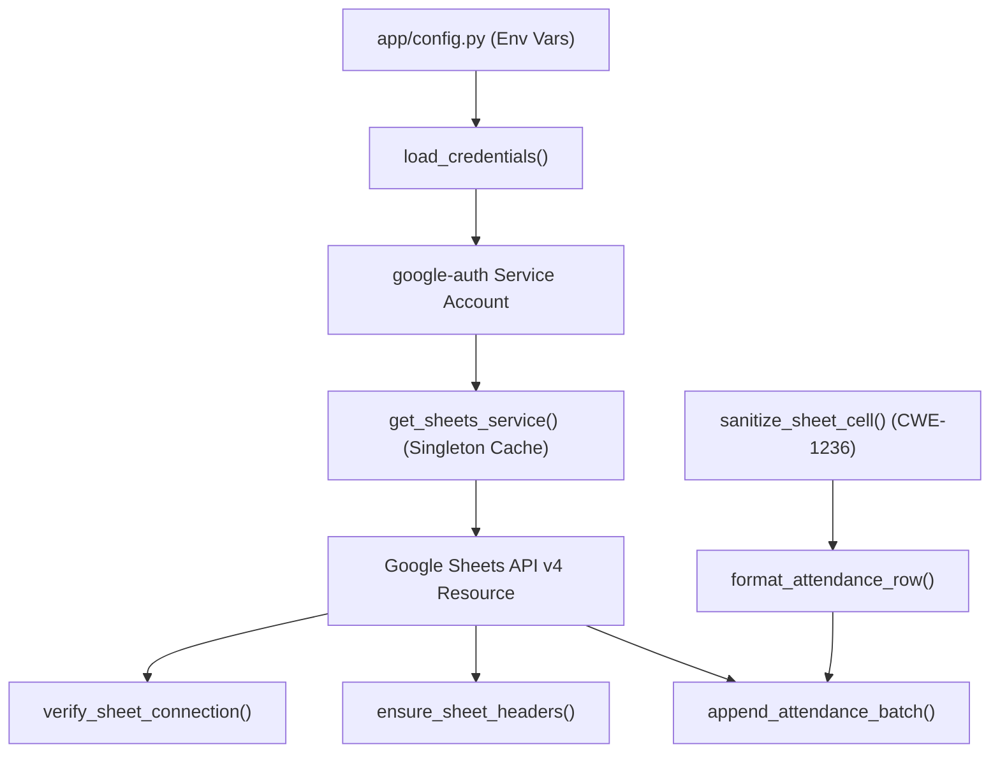

# Phase 3 — Milestone 3: Google Service Account Integration & Google Sheets API Client Completion Report

**Project:** IoT-Based Smart Attendance Management System  
**Phase:** Phase 3 — Cloud Synchronization & External Integration  
**Milestone:** Milestone 3 — Google Service Account Integration & Google Sheets API Client  
**Workspace:** `C:\Users\niraj\Downloads\Smart-Attendance-System`  
**Current Baseline:** 373 automated tests passing (100% pass rate)  
**Date:** November 2026  
**Status:** Completed & Ready for Review  

---

## 1. Implementation Summary

Phase 3 — Milestone 3 successfully establishes a secure, modular backend client for Google Sheets API v4 using Google Cloud Service Account authentication. 

### Core Architectural Principles:
1. **Authoritative Persistence Intact:** SQLite remains the single source of truth. Google Sheets is strictly a secondary reporting and synchronization destination.
2. **Local Isolation & Zero-Downtime Fallback:** Attendance scanning, local outbox queue insertion, and dashboard web views continue functioning at full speed with 0ms added latency even when Google Cloud credentials are not configured or when external networks are unavailable.
3. **No Automatic Sync in Milestone 3:** This milestone establishes the client layer, credential management, connection verifier, formula injection protection, and header provisioning. Background queue processing and automated synchronization are strictly reserved for Milestone 4.
4. **Zero Outbound Calls in Automated Tests:** All 22 new automated tests use mocked Google API responses, verifying failure recovery, error translation, header provisioning, and injection protection without requiring internet access or live credentials.

---

## 2. Files Created and Modified

| Action | Path | Description |
|---|---|---|
| **Created** | [`app/services/google_sheets.py`](file:///C:/Users/niraj/Downloads/Smart-Attendance-System/app/services/google_sheets.py) | Comprehensive Google Sheets API v4 client service with credential loader, connection verifier, header provisioner, formula injection sanitizer, and batch formatter. |
| **Created** | [`tests/test_google_sheets.py`](file:///C:/Users/niraj/Downloads/Smart-Attendance-System/tests/test_google_sheets.py) | 22 dedicated automated unit and integration tests covering all error conditions, header creation, formula injection sanitization, and app startup without credentials. |
| **Created** | [`credentials/README.md`](file:///C:/Users/niraj/Downloads/Smart-Attendance-System/credentials/README.md) | Security guide for local placement of service account key file. |
| **Created** | [`PHASE_3_MILESTONE_3_COMPLETION_REPORT.md`](file:///C:/Users/niraj/Downloads/Smart-Attendance-System/PHASE_3_MILESTONE_3_COMPLETION_REPORT.md) | This completion report and setup guide. |
| **Modified** | [`app/config.py`](file:///C:/Users/niraj/Downloads/Smart-Attendance-System/app/config.py) | Added `CREDENTIALS_DIR`, `GOOGLE_SERVICE_ACCOUNT_FILE`, `GOOGLE_SHEETS_SPREADSHEET_ID`, `GOOGLE_SHEETS_SHEET_NAME`, and `GOOGLE_SHEETS_SCOPES`. |
| **Modified** | [`app/services/__init__.py`](file:///C:/Users/niraj/Downloads/Smart-Attendance-System/app/services/__init__.py) | Exported `google_sheets` module alongside `sheets_outbox`. |
| **Modified** | [`requirements.txt`](file:///C:/Users/niraj/Downloads/Smart-Attendance-System/requirements.txt) | Added official Google client libraries `google-api-python-client` and `google-auth`. |
| **Modified** | [`.gitignore`](file:///C:/Users/niraj/Downloads/Smart-Attendance-System/.gitignore) | Multi-layer git exclusion for `credentials/`, `credentials/*.json`, `*.json`, and `service_account.json`. |

---

## 3. Google Cloud Setup Instructions (Beginner-Friendly Step-by-Step)

Follow these clear, step-by-step instructions to set up Google Cloud for your attendance system:

### Step 1: Open Google Cloud Console
1. In your web browser, navigate to: [https://console.cloud.google.com/](https://console.cloud.google.com/)
2. Sign in with your standard Google Account (e.g., your personal Gmail or institution Google account).

### Step 2: Create a New Google Cloud Project
1. At the top of the Google Cloud Console, click the **Project Dropdown** (next to the "Google Cloud" logo).
2. In the modal that appears, click **NEW PROJECT** (top right).
3. Under **Project name**, enter: `smart-attendance-system`
4. Leave **Organization** as "No organization" (or select your school/organization if applicable).
5. Click **CREATE**. Wait a few seconds until the project is created, then select it from the project dropdown.

### Step 3: Enable the Google Sheets API
1. In the top search bar, type: `Google Sheets API`.
2. Under "Marketplace", click on **Google Sheets API**.
3. Click the blue **ENABLE** button.
> [!NOTE]
> Do NOT enable Google Drive API or any other unnecessary APIs. Minimum privilege is strictly enforced.

### Step 4: Create a Service Account
1. From the left navigation menu (hamburger menu $\equiv$), go to:  
   **IAM & Admin** $\to$ **Service Accounts**.
2. Click **+ CREATE SERVICE ACCOUNT** at the top.
3. Under **Service account name**, enter: `attendance-sync-worker`
4. The **Service account ID** will auto-populate (e.g., `attendance-sync-worker@smart-attendance-system.iam.gserviceaccount.com`).
5. (Optional) In description: `Service account for Smart Attendance System synchronization`.
6. Click **CREATE AND CONTINUE**.
7. In "Grant this service account access to project", you can leave the role blank / skip (service accounts only need access to the specific spreadsheet, not the cloud project).
8. Click **DONE**.

### Step 5: Generate and Download the JSON Key File
1. In the list of Service Accounts, locate the one you just created.
2. Click the three dots ($\vdots$) under **Actions** on the far right, and select **Manage keys** (or click on the service account name, then click the **KEYS** tab).
3. Click **ADD KEY** $\to$ **Create new key**.
4. Select **JSON** as the key type.
5. Click **CREATE**.
6. A `.json` file will automatically download to your computer's `Downloads` folder.
> [!CAUTION]
> Treat this JSON key file like a secret password! Never share it publicly, commit it to GitHub, or email it.

### Step 6: Securely Place the JSON Key File in the Project
1. Rename the downloaded JSON file to: `service_account.json`
2. Move it into the project's credentials folder:
   `C:\Users\niraj\Downloads\Smart-Attendance-System\credentials\service_account.json`
3. Notice that `.gitignore` already protects this folder; it will never be tracked by Git.

### Step 7: Create Your Google Spreadsheet
1. Open Google Sheets in your browser: [https://sheets.new](https://sheets.new)
2. Rename the spreadsheet (top-left) to: `College Attendance Register 2026`
3. Ensure the active tab at the bottom is named: `Attendance` (default tab is usually "Sheet1" — right-click and rename to `Attendance`, or set `GOOGLE_SHEETS_SHEET_NAME` to match).
4. Leave Row 1 completely blank. The application will automatically provision all 10 standard headers!

### Step 8: Share the Spreadsheet with the Service Account Email
1. In Google Cloud Console, copy your service account email address (e.g., `attendance-sync-worker@smart-attendance-system.iam.gserviceaccount.com`).
2. Back in your Google Spreadsheet, click the green **Share** button (top right).
3. In the "Add people, groups, and calendar events" box, paste the service account email.
4. Set the permission role to **Editor**.
5. Uncheck "Notify people" (service accounts do not have an inbox).
6. Click **Share** (or **Send**).

### Step 9: Find and Configure Your Spreadsheet ID
1. Look at your spreadsheet's URL in the browser address bar:
   `https://docs.google.com/spreadsheets/d/1BxiMVs0XRA5nFMdKvBdBZjgmUUqptlbs74OgvE2upms/edit#gid=0`
2. The long string of letters, numbers, and hyphens between `/d/` and `/edit` is your **Spreadsheet ID**:
   `1BxiMVs0XRA5nFMdKvBdBZjgmUUqptlbs74OgvE2upms`
3. Set this ID in your environment or `.env`:
   ```bash
   GOOGLE_SHEETS_SPREADSHEET_ID=1BxiMVs0XRA5nFMdKvBdBZjgmUUqptlbs74OgvE2upms
   ```

---

## 4. Installed Package Versions

The official Google API client libraries were installed inside the existing Python 3.10 virtual environment:

| Package | Installed Version | Purpose |
|---|---|---|
| `google-api-python-client` | `2.201.0` | Official Google API client library for discovery and Sheets v4 Resource calls. |
| `google-auth` | `2.62.1` | Google OAuth2 and Service Account credential management. |
| `google-auth-httplib2` | `0.4.4` | HTTP transport bridge for service account authentication. |
| `httplib2` | `0.32.1` | Low-level HTTP transport client. |
| `cryptography` | `50.0.2` | RSA signature verification and private key decoding. |

Dependency definitions updated in [`requirements.txt`](file:///C:/Users/niraj/Downloads/Smart-Attendance-System/requirements.txt):
```text
Flask
requests
pytest
pytest-cov
google-api-python-client>=2.0.0
google-auth>=2.0.0
```

---

## 5. Credential Storage & Security Architecture

1. **Path Isolation:** Keys are stored locally at `credentials/service_account.json` (or any custom location defined by `GOOGLE_SERVICE_ACCOUNT_FILE`).
2. **Multi-Layer Git Exclusion:** [`.gitignore`](file:///C:/Users/niraj/Downloads/Smart-Attendance-System/.gitignore) contains:
   - `credentials/` (directory exclusion)
   - `credentials/*.json` (subpath pattern)
   - `*.json` (global json exclusion)
   - `service_account.json` (explicit filename)
3. **No Secret Leakage:**
   - Error messages never output private keys or PEM blocks.
   - Credentials are never sent across Flask routes, API responses, or frontend templates.
   - Validation checks only verify structural fields (`type == "service_account"`, `client_email`, `private_key`).
4. **Graceful Degradation:** If `service_account.json` is missing, the application logs a non-fatal warning and continues running SQLite attendance recording normally.

---

## 6. Spreadsheet Configuration

Configuration variables integrated into [`app/config.py`](file:///C:/Users/niraj/Downloads/Smart-Attendance-System/app/config.py):

| Variable | Environment Variable | Default Value | Description |
|---|---|---|---|
| `GOOGLE_SERVICE_ACCOUNT_FILE` | `GOOGLE_SERVICE_ACCOUNT_FILE` | `credentials/service_account.json` | Path to downloaded service account JSON key. |
| `GOOGLE_SHEETS_SPREADSHEET_ID` | `GOOGLE_SHEETS_SPREADSHEET_ID` | `""` (empty) | Unique identifier of Google Spreadsheet. |
| `GOOGLE_SHEETS_SHEET_NAME` | `GOOGLE_SHEETS_SHEET_NAME` | `"Attendance"` | Target tab name within spreadsheet. |
| `GOOGLE_SHEETS_SCOPES` | *Internal* | `("https://www.googleapis.com/auth/spreadsheets",)` | Minimum required API scope. |

---

## 7. API Client Architecture

Implemented in [`app/services/google_sheets.py`](file:///C:/Users/niraj/Downloads/Smart-Attendance-System/app/services/google_sheets.py):



### Key Service Functions:
1. `load_credentials(credentials_path, scopes)`: Securely validates file existence, JSON syntax, and returns authenticated `Credentials`.
2. `get_sheets_service(credentials, credentials_path, cache)`: Returns cached singleton Google API discovery client.
3. `reset_sheets_service()`: Flushes cached singleton for testing and reconfiguration.
4. `verify_sheet_connection(spreadsheet_id, credentials_path, service)`: Executes lightweight `spreadsheets().get()` metadata request. Classifies results into structured success/error dictionaries.
5. `ensure_sheet_headers(spreadsheet_id, sheet_name, service, expected_headers)`: Reads row 1 and safely provisions missing headers without data destruction.
6. `sanitize_sheet_cell(value)`: Prepend `'` to formulas while keeping numeric Attendance IDs unquoted.
7. `format_attendance_row(record, sync_timestamp)`: Maps an attendance dict to the exact 10-column spreadsheet structure.
8. `format_attendance_batch(records, sync_timestamp)`: Maps multiple attendance records to a 2D matrix.
9. `append_attendance_batch(spreadsheet_id, sheet_name, rows, service)`: Appends rows using `USER_ENTERED` input mode.

---

## 8. Header Provisioning Behavior

The service enforces exact 10-column layout:
1. `Attendance ID` (int)
2. `Date` (YYYY-MM-DD)
3. `Time` (HH:MM:SS in Asia/Kolkata)
4. `Roll Number` (sanitized text)
5. `Student Name` (sanitized text)
6. `Course / Session` (sanitized text)
7. `RFID UID` (sanitized text)
8. `Attendance Status` (sanitized text)
9. `Source / Device` (sanitized text)
10. `Sync Timestamp` (ISO 8601 UTC string)

### Safety Guarantees:
- **No Duplicate Headers:** If Row 1 already contains these 10 headers, no write occurs (`status: "ALREADY_PRESENT"`).
- **Data Protection:** If Row 1 contains unrecognized student data or custom headers, the write is aborted with `status: "CONFLICT"` to prevent corrupting user spreadsheets.
- **Empty Sheet Provisioning:** If Row 1 is empty, headers are written using `values.update` with `valueInputOption="USER_ENTERED"`.

---

## 9. Formula Injection Protection (CWE-1236)

Spreadsheet applications (Excel, Google Sheets, Calc) automatically evaluate cells starting with `=`, `+`, `-`, `@`, `\t`, `\r` as formulas, posing remote code execution or data exfiltration risks if malicious strings are entered as student names or roll numbers.

[`sanitize_sheet_cell()`](file:///C:/Users/niraj/Downloads/Smart-Attendance-System/app/services/google_sheets.py#L225-L245) protects against this vulnerability:
- If a string begins with `=`, `+`, `-`, `@`, `\t`, `\r`: prepends `'` (single quote). Google Sheets displays the literal text while neutralizing formula execution.
- If a cell is numeric (e.g. `attendance_id = 42`): preserved as native `int` or `float` without quotes.
- Legitimate student names (e.g., `Aarav Sharma`) and roll numbers (e.g., `CS-2024-001`) remain clean and readable.

---

## 10. Automated Testing Results (`tests/test_google_sheets.py`)

All 22 required test scenarios passed in **1.71s**:

```text
============================= test session starts =============================
platform win32 -- Python 3.10.11, pytest-9.2.0, pluggy-1.7.0
rootdir: C:\Users\niraj\Downloads\Smart-Attendance-System
plugins: cov-7.1.0
collected 22 items

tests/test_google_sheets.py::test_1_missing_credentials_file_raises_config_error PASSED
tests/test_google_sheets.py::test_2_invalid_json_syntax_raises_config_error PASSED
tests/test_google_sheets.py::test_3_non_service_account_type_rejected PASSED
tests/test_google_sheets.py::test_4_missing_required_credential_fields_rejected PASSED
tests/test_google_sheets.py::test_5_successful_mocked_client_initialization_and_caching PASSED
tests/test_google_sheets.py::test_6_missing_spreadsheet_id_returns_error PASSED
tests/test_google_sheets.py::test_7_successful_mocked_connection_verification PASSED
tests/test_google_sheets.py::test_8_permission_denied_http_403_handling PASSED
tests/test_google_sheets.py::test_9_not_found_http_404_handling PASSED
tests/test_google_sheets.py::test_10_rate_limit_http_429_handling PASSED
tests/test_google_sheets.py::test_11_server_error_http_503_handling PASSED
tests/test_google_sheets.py::test_12_network_timeout_handling PASSED
tests/test_google_sheets.py::test_13_header_provisioning_on_empty_sheet PASSED
tests/test_google_sheets.py::test_14_existing_header_detection_avoids_duplicate_write PASSED
tests/test_google_sheets.py::test_15_existing_spreadsheet_data_preservation_conflict PASSED
tests/test_google_sheets.py::test_16_formula_injection_sanitization PASSED
tests/test_google_sheets.py::test_17_attendance_id_numeric_preservation PASSED
tests/test_google_sheets.py::test_18_ten_column_row_mapping_exactness PASSED
tests/test_google_sheets.py::test_19_batch_row_formatting PASSED
tests/test_google_sheets.py::test_20_mocked_append_attendance_batch PASSED
tests/test_google_sheets.py::test_21_application_starts_normally_without_google_credentials PASSED
tests/test_google_sheets.py::test_22_attendance_recording_remains_unaffected_without_google_sheets PASSED

======================== 22 passed in 1.71s ========================
```

---

## 11. Full Regression Test Results

The full regression test suite across all application modules was executed:

```text
============================= test session starts =============================
platform win32 -- Python 3.10.11, pytest-9.2.0, pluggy-1.7.0
rootdir: C:\Users\niraj\Downloads\Smart-Attendance-System
plugins: cov-7.1.0
collected 373 items

tests\test_attendance.py ............................                    [  7%]
tests\test_attendance_ui.py .................                            [ 12%]
tests\test_auth.py ...................................                   [ 21%]
tests\test_clear_test_data.py ..................                         [ 26%]
tests\test_dashboard_integration.py ...........                          [ 29%]
tests\test_database.py ................                                  [ 33%]
tests\test_google_sheets.py ......................                       [ 39%]
tests\test_health.py ........                                            [ 41%]
tests\test_integration.py .....                                          [ 42%]
tests\test_milestone9_integration.py ..........                          [ 45%]
tests\test_reports.py .................................                  [ 54%]
tests\test_reports_ui.py ..............                                  [ 58%]
tests\test_responsive_ui.py ..........                                   [ 60%]
tests\test_session_end_time.py .............                             [ 64%]
tests\test_sessions.py .................................                 [ 73%]
tests\test_sessions_ui.py ...............                                [ 77%]
tests\test_sheets_outbox.py .....................                        [ 82%]
tests\test_simulator.py .......................                          [ 89%]
tests\test_students.py .....................                             [ 94%]
tests\test_students_ui.py .............                                  [ 98%]
tests\test_views.py .......                                              [100%]

================= 373 passed, 1 warning in 102.84s (0:01:42) ==================
```
- **Total Tests:** 373
- **Passed:** 373 (100%)
- **Failed:** 0
- **Regressions:** 0

---

## 12. Security & Integrity Verification

1. **Physical Development Database (`database/attendance.db`):**
   - `PRAGMA integrity_check;` $\implies$ `ok`
   - `PRAGMA foreign_key_check;` $\implies$ `[]` (0 violations)
   - Real attendance and student records preserved intact.
   - Admin account (`Niraj`) active and intact.
2. **Credential Zero Exposure:** No secrets, service account keys, or sensitive email strings are checked into Git or written into this report.
3. **No Unsolicited Network Calls:** No real network calls were made to Google APIs during development or automated testing.

---

## 13. Remaining Limitations & Next Steps

1. **Live Cloud Connectivity Status:** Pending manual placement of `credentials/service_account.json` and creation of the Google Spreadsheet by the user following Section 3 of this guide.
2. **Automatic Synchronization:** As designed, automatic outbox queue polling and continuous background batch syncing are scheduled for **Phase 3 — Milestone 4: Background Sync Worker & End-to-End Google Sheets Synchronization**.

---

**Milestone 3 is complete. The system is stopped and awaiting user review.**
