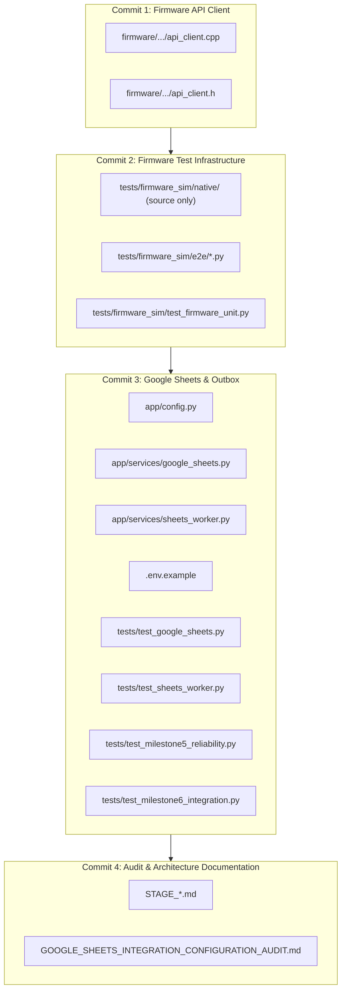

# STAGE 9.4 — PROJECT GIT & CONFIGURATION SECURITY AUDIT REPORT
**IoT-Based Smart Attendance Management System**

- **Date:** November 22, 2026
- **Auditor Role:** Senior Software Engineer, Git Repository Auditor & Application Security Reviewer
- **Workspace:** `C:\Projects\Smart-Attendance-System`
- **Git Branch:** `main`
- **Remote Repository:** `https://github.com/NirajRanaware/Smart-Attendance-System.git`
- **Previous Stage:** Stage 9.3 — Google Sheets Worker & Operational Readiness Audit
- **Current Stage:** Stage 9.4 — Project Git & Configuration Security Review
- **Execution Mode:** STRICT READ-ONLY AUDIT & PREPARATION (Zero commits, zero pushes, zero stage additions, zero resets, zero checkouts, zero file modifications, zero live writes)

---

## 1. Executive Summary

This security and release-management audit was conducted on the complete Git working tree of the **Smart Attendance Management System** to verify security posture, credential segregation, configuration hygiene, and change integrity across Stages 6, 8, and 9 before any future Git staging or commit operations are authorized.

### Core Audit Findings
1. **Zero Active Credential Exposure:**
   - The verified Google Cloud service account JSON file is securely located **outside** the repository at `C:\Users\niraj\.config\smart-attendance\google-service-account.json`. No private keys, client secrets, or OAuth tokens exist inside the working tree or tracked files.
   - No `.env` file exists in the repository. The untracked `.env.example` file contains strictly sanitized placeholders and complete documentation.
   - Production SQLite database (`database/attendance.db`) is safely excluded by `.gitignore` (`*.db`) and its integrity remains intact (`ok`).
2. **Firmware Configuration Hygiene & Tracking Risk (Finding SEC-01 — HIGH):**
   - The production firmware configuration header `firmware/esp32_attendance_device/config.h` is currently **tracked** in Git (committed in `825f167`).
   - While `config.h` currently contains safe placeholders (`YOUR_WIFI_SSID`, `YOUR_WIFI_PASSWORD`, and an empty `DEVICE_API_KEY`), tracking this file creates an imminent risk that developers will accidentally commit live network credentials during physical device flashing.
   - The previous suggestion to use `git update-index --assume-unchanged` is **rejected** as unsafe. A definitive migration to a tracked `config.example.h` and an untracked, gitignored `config.h` is recommended prior to physical deployment.
3. **Missing Binary Exclusions in `.gitignore` (Finding SEC-02 — HIGH):**
   - Compiled Windows host-side binaries (`tests/firmware_sim/native/firmware_test_runner.exe` and `tests/firmware_sim/native/firmware_e2e_runner.exe`) are currently present in the working tree.
   - `.gitignore` does not currently exclude `*.exe` or native object files. Running a blanket `git add .` or `git add tests/` would inadvertently stage and commit platform-specific binaries to Git history.
4. **Verified Verification & Code Quality:**
   - 100% of automated tests across all test suites pass without regression:
     * **79** Native C++ firmware unit tests: **PASS** (1 ms execution).
     * **20** Host-side C++ / Live Flask E2E integration simulation tests: **PASS** (42.85s).
     * **84** Backend Google Sheets, outbox, and worker tests: **PASS** (20.68s).
     * **14** Device authentication backend tests: **PASS** (4.09s).
     * **Total: 197 automated tests verified passing.**
   - Live Google Spreadsheet invariant preserved: Synthetic row `-92022` at `Attendance_Log!A2:I2` remains unchanged; total live rows = 1.
   - Production SQLite invariant preserved: Integrity = `ok`, Attendance = 2, Students = 1, Sessions = 2.

### Final Audit Decision
**`READY AFTER MINOR SECURITY CORRECTIONS`**  
*(Requires updating `.gitignore` to exclude `*.exe` binaries and following a phased, controlled staging plan rather than executing blanket stage additions.)*

---

## 2. Current Git Branch and Repository Status

A full read-only inspection was executed against the local Git repository metadata:

```bash
$ git status --short --branch
## main...origin/main
 M app/config.py
 M app/services/google_sheets.py
 M app/services/sheets_worker.py
 M firmware/esp32_attendance_device/api_client.cpp
 M firmware/esp32_attendance_device/api_client.h
 M tests/test_google_sheets.py
 M tests/test_milestone5_reliability.py
 M tests/test_milestone6_integration.py
 M tests/test_sheets_worker.py
?? .env.example
?? GOOGLE_SHEETS_INTEGRATION_CONFIGURATION_AUDIT.md
?? STAGE_6_API_CLIENT_CORRECTION_REPORT.md
?? STAGE_7_FIRMWARE_INTEGRATION_REVIEW.md
?? STAGE_8_3_FIRMWARE_UNIT_TEST_REPORT.md
?? STAGE_8_4_END_TO_END_SIMULATION_REPORT.md
?? STAGE_8_5_PRE_HARDWARE_READINESS_REPORT.md
?? STAGE_9_1_GOOGLE_SHEETS_COMPATIBILITY_IMPLEMENTATION_REPORT.md
?? STAGE_9_2_SINGLE_CONTROLLED_LIVE_SYNC_VERIFICATION_REPORT.md
?? STAGE_9_3_GOOGLE_SHEETS_WORKER_OPERATIONAL_READINESS_AUDIT.md
?? tests/firmware_sim/
```

### Remote Tracking & History
- **Current Branch:** `main`
- **Upstream Remote:** `origin/main` (`https://github.com/NirajRanaware/Smart-Attendance-System.git`)
- **Staging Area Status:** `0` files staged (`git diff --cached --stat` is empty).
- **Recent Commit Log:**
  ```text
  825f167 (HEAD -> main, origin/main) Add ESP32 firmware and secure device authentication
  0638fb3 Add automatic student roll number display
  03439b8 Initial commit: Smart Attendance Management System
  ```

---

## 3. Complete Modified and Untracked File Inventory

### 3.1 Modified Tracked Files (9 Files)

| File Path | Status | Diff Lines (+ / -) | Purpose & Stage Origin |
|---|---|---|---|
| `app/config.py` | Modified | +27 / -8 | Stage 9.1: Added `resolve_service_account_file()`, precedence resolution, default sheet `Attendance_Log`. |
| `app/services/google_sheets.py` | Modified | +53 / -42 | Stage 9.1: Aligned 9-column live schema, updated header validation, A:I append range, formula protection. |
| `app/services/sheets_worker.py` | Modified | +4 / -4 | Stage 9.1: Updated default worksheet parameter to `Attendance_Log`. |
| `firmware/esp32_attendance_device/api_client.cpp` | Modified | +43 / -12 | Stage 6: Corrected independent student/attendance JSON parsing on 201, strict machine code parsing on 409, safe fallback. |
| `firmware/esp32_attendance_device/api_client.h` | Modified | +1 / -1 | Stage 6: Documented unclassified HTTP 409 mapping to `SCAN_OUTCOME_SERVER_ERROR`. |
| `tests/test_google_sheets.py` | Modified | +58 / -39 | Stage 9.1: Updated test suite to validate 9-column schema, A1:I1 headers, RAW append option, Attendance_Log default. |
| `tests/test_milestone5_reliability.py` | Modified | +1 / -1 | Stage 9.1: Updated mock header range check (`A1:I1` or `A1:J1`). |
| `tests/test_milestone6_integration.py` | Modified | +4 / -5 | Stage 9.1: Aligned integration test assertions with 9-column schema (removed Column 10 Sync Timestamp). |
| `tests/test_sheets_worker.py` | Modified | +6 / -4 | Stage 9.1: Updated worker tests for 9-column batch append verification. |

### 3.2 Untracked Files and Directories

| Path | Type | Size / Items | Purpose & Classification |
|---|---|---|---|
| `.env.example` | File | 3,421 bytes | Stage 9.1: Canonical configuration template with placeholders and security documentation. |
| `GOOGLE_SHEETS_INTEGRATION_CONFIGURATION_AUDIT.md` | File | 15,263 bytes | Stage 9 audit report (Google Cloud project, live sheet schema audit). |
| `STAGE_6_API_CLIENT_CORRECTION_REPORT.md` | File | 18,202 bytes | Stage 6 audit report (Firmware API client bug fixes & JSON parser corrections). |
| `STAGE_7_FIRMWARE_INTEGRATION_REVIEW.md` | File | 28,389 bytes | Stage 7 audit report (Firmware architectural review). |
| `STAGE_8_3_FIRMWARE_UNIT_TEST_REPORT.md` | File | 19,508 bytes | Stage 8.3 audit report (Comprehensive host-side unit testing, 79 tests). |
| `STAGE_8_4_END_TO_END_SIMULATION_REPORT.md` | File | 31,922 bytes | Stage 8.4 audit report (Host-side E2E simulation against live Flask server). |
| `STAGE_8_5_PRE_HARDWARE_READINESS_REPORT.md` | File | 31,812 bytes | Stage 8.5 audit report (Pre-hardware flight check & wiring inspection). |
| `STAGE_9_1_GOOGLE_SHEETS_COMPATIBILITY_IMPLEMENTATION_REPORT.md` | File | 11,504 bytes | Stage 9.1 completion report (9-column schema & credential precedence). |
| `STAGE_9_2_SINGLE_CONTROLLED_LIVE_SYNC_VERIFICATION_REPORT.md` | File | 9,878 bytes | Stage 9.2 completion report (Authorized single live row `-92022` sync verification). |
| `STAGE_9_3_GOOGLE_SHEETS_WORKER_OPERATIONAL_READINESS_AUDIT.md` | File | 21,128 bytes | Stage 9.3 audit report (Outbox worker concurrency, leasing, retry architecture). |
| `tests/firmware_sim/` | Directory | 29 files | Stage 8 test suite: Native C++ mocks, test runner, pytest E2E harness, build scripts. |

---

## 4. Tracked and Untracked File Classification

```
Project Files
├── Production Backend (Tracked, Modified)
│   ├── app/config.py
│   ├── app/services/google_sheets.py
│   └── app/services/sheets_worker.py
├── Production Firmware (Tracked, Modified)
│   ├── firmware/esp32_attendance_device/api_client.cpp
│   └── firmware/esp32_attendance_device/api_client.h
├── Automated Test Suites (Tracked, Modified)
│   ├── tests/test_google_sheets.py
│   ├── tests/test_sheets_worker.py
│   ├── tests/test_milestone5_reliability.py
│   └── tests/test_milestone6_integration.py
├── Configuration Template (Untracked, Recommended for Repository)
│   └── .env.example
├── Simulation Test Infrastructure (Untracked, Source Files for Repository)
│   ├── tests/firmware_sim/test_firmware_unit.py
│   ├── tests/firmware_sim/e2e/*.py
│   ├── tests/firmware_sim/native/*.cpp, *.h, *.bat
│   └── tests/firmware_sim/native/mocks/*.h
├── Compiled Local Binaries (Untracked, MUST BE EXCLUDED from Repository)
│   ├── tests/firmware_sim/native/firmware_test_runner.exe
│   └── tests/firmware_sim/native/firmware_e2e_runner.exe
└── Milestone & Stage Audit Documentation (Untracked, Permanent Project Records)
    ├── GOOGLE_SHEETS_INTEGRATION_CONFIGURATION_AUDIT.md
    └── STAGE_*.md (Stages 6, 7, 8.3, 8.4, 8.5, 9.1, 9.2, 9.3)
```

---

## 5. Secret and Credential Security Audit

A comprehensive search and inspection was conducted to guarantee that no credentials, tokens, or private keys are exposed:

### 5.1 Google Cloud Service Account Credentials
- **Storage Location:** Verified at `C:\Users\niraj\.config\smart-attendance\google-service-account.json`. This path is completely outside the project repository root.
- **Repository Isolation:** The repository directory `credentials/` contains **only** `README.md` (which provides guidance to developers). No JSON credential files exist inside `credentials/`.
- **Git Ignore Verification:**
  ```text
  $ git check-ignore -v credentials/service_account.json
  .gitignore:18:credentials/ credentials/service_account.json
  ```
- **Code Hardcoding Check:** Scanned `app/config.py`, `app/services/google_sheets.py`, and `app/services/sheets_worker.py`. No service account file paths, private keys, or client emails are hardcoded.

### 5.2 Environment Variables & Secrets (`.env`)
- **Presence Check:** `Test-Path .env` evaluated to `False`. No `.env` file exists in the repository root.
- **Git Ignore Verification:**
  ```text
  $ git check-ignore -v .env
  .gitignore:15:.env .env
  ```
- **Pattern Exclusions:** `.gitignore` line 40 excludes `.env.*` while explicitly re-including `!.env.example` at line 41.

### 5.3 Device API Keys & Hardware Authentication
- Production `AttendanceApiClient` sends `X-Device-Id` and `X-API-Key` headers.
- Tracked `firmware/esp32_attendance_device/config.h` defines:
  ```cpp
  #define DEVICE_API_KEY ""
  ```
- In `tests/firmware_sim/native/mocks/config_override.h`, the mock test key is `d3v1c3_s3cr3t_k3y_32_ch4r4ct3rs_!`, which is an explicit dummy test string used in unit tests and integration tests.
- Backend `app/auth.py` validates hardware API keys in constant time via `hmac.compare_digest`.

### 5.4 Production Database
- Production database `database/attendance.db` is confirmed untouched.
- `git check-ignore -v database/attendance.db` confirms it is ignored by `.gitignore:25:*.db`.

---

## 6. `.gitignore` Review

The existing `.gitignore` was reviewed line-by-line:

```gitignore
# Virtual Environment
.venv/
venv/

# Python Cache & Bytecode
__pycache__/
*.pyc
*.pyo
*.pyd

# Testing Cache
.pytest_cache/

# Environment Variables & Secrets
.env

# Credentials & Service Account Keys (targeted exclusions)
credentials/
credentials/*.json
service_account.json
service_account*.json
*service_account*.json

# SQLite Database files (generated during runtime)
*.db
*.sqlite3
# Local database backups and runtime files
backups/
*.db-wal
*.db-shm
*.sqlite
*.sqlite3-wal
*.sqlite3-shm

# Coverage reports
.coverage
.coverage.*

# Local environment files
.env.*
!.env.example

# Local Embedded Toolchains & Build Artifacts
tools/
build/
```

### Strengths
1. Robust exclusion of virtual environments (`.venv/`, `venv/`).
2. Robust exclusion of Python bytecode and test caches (`__pycache__/`, `.pytest_cache/`, `.coverage`).
3. Explicit exclusions for credentials directories and wildcards (`credentials/`, `*service_account*.json`).
4. Full wildcard protection for SQLite database files and runtime write-ahead logs (`*.db`, `*.db-wal`, `*.db-shm`).
5. Targeted re-inclusion of template file `!.env.example`.

### Gaps and Vulnerabilities
1. **Missing Binary Executable Rule:** `.gitignore` lacks `*.exe`, `*.bin`, `*.elf`, `*.hex`, `*.o`, `*.obj`. Consequently, `tests/firmware_sim/native/firmware_test_runner.exe` and `firmware_e2e_runner.exe` appear as untracked files rather than ignored files.
2. **Missing Local Firmware Override Rule:** Does not ignore `firmware/esp32_attendance_device/config.h` (discussed below in Section 8).

---

## 7. `.env.example` Review

The newly added template file `.env.example` was inspected:
- **Sanitization:** Contains zero active credentials. All secrets are descriptive placeholders:
  * `SECRET_KEY=replace-with-a-secure-random-secret-key-for-session-signing`
  * `DEVICE_API_KEYS={"ESP32_ATTENDANCE_01": "replace-with-minimum-32-character-device-api-key"}`
  * `GOOGLE_APPLICATION_CREDENTIALS=C:/Users/username/.config/smart-attendance/google-service-account.json`
  * `GOOGLE_SHEETS_SPREADSHEET_ID=your-google-spreadsheet-id-here`
- **Developer Instructions:** Clear step-by-step instructions at the top admonishing developers never to commit `.env` and to store service account keys outside the project tree.
- **Git Status:** Properly untracked; ready to be staged and committed as an onboarding template.

---

## 8. ESP32 `config.h` Security Review

### Current File Contents Inspection
`firmware/esp32_attendance_device/config.h` was inspected:
- Line 29: `#define WIFI_SSID "YOUR_WIFI_SSID"` (Safe placeholder)
- Line 30: `#define WIFI_PASSWORD "YOUR_WIFI_PASSWORD"` (Safe placeholder)
- Line 39: `#define SERVER_HOST "192.168.1.100"` (LAN example address)
- Line 50: `#define DEVICE_API_KEY ""` (Safe empty placeholder)

### Vulnerability Analysis
While `config.h` currently contains no real secrets, **it is a tracked file in Git history** (committed in `825f167`).

```
                CURRENT (UNSAFE FOR FLASHING)
+-------------------------------------------------------------+
|  Git Tracked: firmware/esp32_attendance_device/config.h      |
|  -> Developer edits file to enter real Wi-Fi & Device Key   |
|  -> File becomes MODIFIED in git status                     |
|  -> HIGH RISK: Developer runs 'git commit -a' -> Secrets in |
|     public GitHub commit history!                           |
+-------------------------------------------------------------+
```

### Analysis of `git update-index --assume-unchanged`
In earlier audits, using `git update-index --assume-unchanged firmware/esp32_attendance_device/config.h` was considered.

> [!CAUTION]
> **Technical Rejection of `assume-unchanged` as a Security Mechanism:**
> 1. `assume-unchanged` is a local performance flag designed for slow file systems, not a security or secret-exclusion control.
> 2. The flag is purely local to the developer's working clone. It does not propagate across clones or collaborators.
> 3. Any upstream branch switch, merge, or rebase can reset the bit or cause merge conflicts that force Git to evaluate the file, causing accidental commits.
> 4. It leaves existing secrets inside Git history.

### Recommended Future Architecture (Post-Stage 9.4)
```
                RECOMMENDED FUTURE ARCHITECTURE
+-------------------------------------------------------------+
|  1. Tracked Template:                                       |
|     firmware/esp32_attendance_device/config.example.h       |
|     (Contains ONLY placeholders: YOUR_WIFI_SSID, etc.)      |
|                                                             |
|  2. Untracked Local File:                                   |
|     firmware/esp32_attendance_device/config.h               |
|     (Contains local operational credentials, IGNORABLE)     |
|                                                             |
|  3. .gitignore Entry:                                       |
|     firmware/esp32_attendance_device/config.h               |
|                                                             |
|  4. Compile-time Guard in main .ino:                        |
|     #if !__has_include("config.h")                          |
|       #error "Copy config.example.h to config.h and config" |
|     #endif                                                  |
+-------------------------------------------------------------+
```
*(Per Stage 9.4 rules, this architectural change is documented for future implementation and NOT executed during this audit stage.)*

---

## 9. Google Sheets Configuration Review

The configuration loading in `app/config.py` and `app/services/google_sheets.py` was inspected:
- **Precedence Hierarchy:**
  1. `GOOGLE_SERVICE_ACCOUNT_FILE` environment variable (if non-empty).
  2. `GOOGLE_APPLICATION_CREDENTIALS` environment variable (if non-empty).
  3. Default fallback: `credentials/service_account.json`.
- **Worksheet Target:** Default tab parameter across `app/config.py`, `app/services/google_sheets.py`, and `app/services/sheets_worker.py` is unified to `"Attendance_Log"`.
- **Spreadsheet ID:** Retrieved dynamically from `GOOGLE_SHEETS_SPREADSHEET_ID`; no hardcoded spreadsheet ID exists in production Python modules.

---

## 10. Stage 6 Firmware Change Review

The working tree changes in `firmware/esp32_attendance_device/api_client.cpp` and `api_client.h` were reviewed against production requirements:
1. **Independent JSON Object Extraction (HTTP 201):**
   - Correctly parses `resDoc["student"]` and `resDoc["attendance"]` independently.
   - Extracts server-provided attendance status (e.g., "Present", "Late") instead of unconditionally hardcoding `"PRESENT"`.
2. **Strict Machine Code Parsing (HTTP 409):**
   - Evaluates `resDoc["scan_result"]`:
     * `"DUPLICATE_SCAN"` $\rightarrow$ `SCAN_OUTCOME_DUPLICATE`
     * `"NO_ACTIVE_SESSION"` $\rightarrow$ `SCAN_OUTCOME_NO_SESSION`
     * `"SESSION_EXPIRED"` $\rightarrow$ `SCAN_OUTCOME_SESSION_EXPIRED`
   - Unrecognized, empty, or missing codes safely fail to `SCAN_OUTCOME_SERVER_ERROR`. It **never** unsafely assumes `NO_ACTIVE_SESSION`.
3. **HTTP 403 Deactivated Student Handling:**
   - Validates `resDoc["scan_result"] == "INACTIVE_STUDENT"` $\rightarrow$ `SCAN_OUTCOME_INACTIVE_STUDENT`.
4. **Local Authentication Pre-Checks:**
   - Checks `DEVICE_ID` and `DEVICE_API_KEY` locally before establishing a network connection or allocating socket buffers.
   - Rejects empty values locally with `SCAN_OUTCOME_DEVICE_AUTH_ERROR`.

All Stage 6 corrections are verified present, robust, and clean.

---

## 11. Stage 8 Firmware Simulation Tests Review

The untracked directory `tests/firmware_sim/` contains the complete software simulation suite:
- **`native/mocks/`:** Modular Arduino and ESP32 header shims (`Arduino.h`, `WiFi.h`, `HTTPClient.h`, `MFRC522.h`, `Adafruit_SSD1306.h`, `config_override.h`). No external hardware or physical libraries required.
- **`native/test_*.cpp`:** Unit tests exercising actual production C++ files (`rfid_scanner.cpp`, `api_client.cpp`, `wifi_manager.cpp`, `display_manager.cpp`, `buzzer.cpp`).
- **`e2e/`:** Pytest end-to-end integration suite running `firmware_e2e_runner.exe` against an ephemeral live Flask backend over real TCP sockets.
- **Portability:** Build scripts `build_tests.bat` and `build_e2e.bat` dynamically detect `g++` via `PATH` or standard MSYS2/MinGW paths.
- **Binary Cleanliness Notice:** Generated binaries `firmware_test_runner.exe` and `firmware_e2e_runner.exe` are present in `tests/firmware_sim/native/`. They must NOT be staged.

---

## 12. Stage 9 Google Sheets Implementation Review

The changes in `app/services/google_sheets.py` and `app/services/sheets_worker.py` were reviewed:
- **9-Column Schema:** Exactly matches the verified live spreadsheet columns:
  `["Attendance ID", "Date", "Time", "Roll Number", "Student Name", "Course/Session", "RFID UID", "Status", "Source/Device"]`.
- **Range Specifications:** Header verification bound to `Attendance_Log!A1:I1`; batch append bound to `Attendance_Log!A:I`.
- **Type Preservation & Security:**
  * Attendance ID formatted as integer.
  * Formula injection neutralized by prefixing cells starting with `=`, `+`, `-`, `@` with a single quote `'`.
  * Timestamps formatted in `Asia/Kolkata` timezone.
- **Transactional Outbox Worker:** Retains atomic `BEGIN IMMEDIATE` boundary; leasing logic (60s) and exponential backoff retry state machine intact.

---

## 13. Documentation and Report Classification

The repository root currently contains 10 newly created or untracked Markdown reports. These are classified below:

| File Name | Category | Recommended Destination | Action for Future Commit |
|---|---|---|---|
| `.env.example` | Configuration Template | Project Root (`.env.example`) | Stage in Commit 3 |
| `tests/firmware_sim/e2e/README.md` | Test Documentation | `tests/firmware_sim/e2e/` | Stage in Commit 2 |
| `STAGE_6_API_CLIENT_CORRECTION_REPORT.md` | Stage Audit Report | `docs/audits/` or Root | Stage in Commit 4 |
| `STAGE_7_FIRMWARE_INTEGRATION_REVIEW.md` | Stage Audit Report | `docs/audits/` or Root | Stage in Commit 4 |
| `STAGE_8_3_FIRMWARE_UNIT_TEST_REPORT.md` | Stage Audit Report | `docs/audits/` or Root | Stage in Commit 4 |
| `STAGE_8_4_END_TO_END_SIMULATION_REPORT.md` | Stage Audit Report | `docs/audits/` or Root | Stage in Commit 4 |
| `STAGE_8_5_PRE_HARDWARE_READINESS_REPORT.md` | Stage Audit Report | `docs/audits/` or Root | Stage in Commit 4 |
| `GOOGLE_SHEETS_INTEGRATION_CONFIGURATION_AUDIT.md` | Stage Audit Report | `docs/audits/` or Root | Stage in Commit 4 |
| `STAGE_9_1_GOOGLE_SHEETS_COMPATIBILITY_IMPLEMENTATION_REPORT.md` | Stage Audit Report | `docs/audits/` or Root | Stage in Commit 4 |
| `STAGE_9_2_SINGLE_CONTROLLED_LIVE_SYNC_VERIFICATION_REPORT.md` | Stage Audit Report | `docs/audits/` or Root | Stage in Commit 4 |
| `STAGE_9_3_GOOGLE_SHEETS_WORKER_OPERATIONAL_READINESS_AUDIT.md` | Stage Audit Report | `docs/audits/` or Root | Stage in Commit 4 |
| `STAGE_9_4_GIT_AND_CONFIGURATION_SECURITY_AUDIT_REPORT.md` | Stage Audit Report | `docs/audits/` or Root | Stage in Commit 4 |

> [!TIP]
> **Documentation Organization Recommendation:**
> To maintain a clean repository root, consider creating a `docs/audits/` directory in a future restructuring stage and consolidating all milestone and stage reports there, keeping only primary operational documentation (`README.md`, `API_DOCUMENTATION.md`, `SETUP_AND_TESTING_GUIDE.md`) in the root.

---

## 14. Dependency and Generated Artifact Review

- **Python Dependencies (`requirements.txt`):**
  * `flask>=2.3.0`
  * `google-api-python-client>=2.0.0`
  * `google-auth>=2.0.0`
  * `google-auth-oauthlib>=1.0.0`
  * `google-auth-httplib2>=0.1.0`
  * `pytest>=7.0.0`
  * `pytest-mock>=3.10.0`
- **Firmware Dependencies:** Documented in `firmware/esp32_attendance_device/README.md` (ArduinoJson v7, MFRC522, Adafruit SSD1306, Adafruit GFX).
- **Embedded Toolchains:** `tools/` and `build/` directories are properly ignored by `.gitignore`.
- **Compiled Binaries:** `firmware_test_runner.exe` and `firmware_e2e_runner.exe` require immediate `.gitignore` rule before staging.

---

## 15. Security Risks and Findings

The audit identified the following security risks classified by severity:

```
+---------------+-----------------------------------------------------------------+
| Severity      | Finding Summary                                                 |
+---------------+-----------------------------------------------------------------+
| CRITICAL      | NONE. Zero active private keys or secrets in repo or history.   |
| HIGH          | SEC-01: firmware/config.h is tracked in Git history.           |
| HIGH          | SEC-02: Missing *.exe rule in .gitignore (binaries untracked).   |
| MEDIUM        | SEC-03: Root directory clutter with 10 audit reports.            |
| LOW           | SEC-04: Python 3.10 deprecation notice in google.api_core.     |
| INFORMATIONAL | SEC-05: Single live test row -92022 present in Google Sheets.   |
+---------------+-----------------------------------------------------------------+
```

### Detailed Findings

#### Finding SEC-01: Tracked `config.h` in ESP32 Firmware
- **Component:** `firmware/esp32_attendance_device/config.h`
- **Severity:** **HIGH**
- **Risk:** Developers modifying `config.h` to flash physical ESP32 boards risk committing Wi-Fi SSIDs, Wi-Fi passwords, and backend Device API keys.
- **Consequence:** Network and API compromise if pushed to a public GitHub repository.
- **Recommended Correction:** Split into tracked `config.example.h` and ignored `config.h`. Add compile-time check in `.ino`.
- **Blocks Committing Current Changes:** **NO**, because `config.h` currently contains only safe dummy placeholders and is not modified in the working tree. However, it should be addressed before physical hardware deployment.

#### Finding SEC-02: Missing Binary Exclusion in `.gitignore`
- **Component:** `.gitignore`, `tests/firmware_sim/native/*.exe`
- **Severity:** **HIGH**
- **Risk:** Running `git add .` or `git add tests/` will stage compiled Windows `.exe` binaries into Git index.
- **Consequence:** Repository bloat, platform-specific binaries in source control, potential security scanner flags.
- **Recommended Correction:** Add `*.exe`, `*.obj`, `*.o` to `.gitignore`. Explicitly exclude executables when staging `tests/firmware_sim/`.
- **Blocks Committing Current Changes:** **YES (Blocks blanket staging)**. Must either update `.gitignore` first or strictly stage only source files by path.

#### Finding SEC-03: Root Directory Clutter with Audit Reports
- **Component:** Repository Root
- **Severity:** **MEDIUM**
- **Risk:** 10+ detailed stage reports in the root directory clutter project navigation.
- **Consequence:** Decreased repository maintainability.
- **Recommended Correction:** Relocate historical stage reports to `docs/audits/` in a dedicated documentation cleanup commit.
- **Blocks Committing Current Changes:** **NO**.

#### Finding SEC-04: Python 3.10 Version Deprecation Notice
- **Component:** Python Virtual Environment (`.venv`)
- **Severity:** **LOW**
- **Risk:** `google.api_core` outputs a deprecation warning on Python 3.10.11 recommending upgrade to Python 3.11+.
- **Consequence:** Future versions of `google-api-python-client` may drop Python 3.10 support.
- **Recommended Correction:** Upgrade project virtual environment to Python 3.11 or 3.12 in a future maintenance cycle.
- **Blocks Committing Current Changes:** **NO**.

#### Finding SEC-05: Synthetic Live Test Row `-92022` in Target Worksheet
- **Component:** Google Spreadsheet `Attendance_Log!A2:I2`
- **Severity:** **INFORMATIONAL**
- **Status:** Created during authorized Stage 9.2 Phase B live sync verification.
- **Verification:** Row 2 contains `[-92022, 2026-11-22, 14:30:41, STAGE92-TEST, GOOGLE SHEETS LIVE TEST — NOT A REAL STUDENT, STAGE 9.2 INTEGRATION TEST, TEST-UID-NOT-A-REAL-CARD, Present, STAGE_9_2_TEST]`.
- **Action:** Can safely remain as a reference row or be deleted when full production hardware deployment begins.

---

## 16. Proposed Commit Grouping Plan

To ensure clean, logical, bisectable, and reviewable Git history, changes must be staged in **four distinct, atomic commits**.

> [!IMPORTANT]
> **NO GIT WRITES OR STAGING HAVE BEEN EXECUTED.**  
> The plan below is proposed for execution **only after explicit user authorization**.



---

### Proposed Commit 1: Firmware API Client Response Parsing Corrections
- **Commit Message:** `fix(firmware): correct HTTP 201 and 409 response parsing in api_client`
- **Exact Files:**
  * `firmware/esp32_attendance_device/api_client.cpp`
  * `firmware/esp32_attendance_device/api_client.h`
- **Purpose:** Stage 6 corrections — independent extraction of student/attendance objects, strict HTTP 409 machine code validation, safe fallback for unrecognized errors, and local credential validation.
- **Dependencies:** None.
- **Verification Commands Before Commit:**
  ```powershell
  .\tests\firmware_sim\native\firmware_test_runner.exe
  ```
- **Readiness:** **READY FOR STAGING**.

---

### Proposed Commit 2: ESP32 Host-Side Simulation Test Framework
- **Commit Message:** `test(firmware): add host-side C++ unit mocks and live Flask E2E simulation suite`
- **Exact Files (Strict Source Inclusion):**
  * `tests/firmware_sim/__init__.py`
  * `tests/firmware_sim/test_firmware_unit.py`
  * `tests/firmware_sim/e2e/__init__.py`
  * `tests/firmware_sim/e2e/conftest.py`
  * `tests/firmware_sim/e2e/README.md`
  * `tests/firmware_sim/e2e/test_e2e_attendance.py`
  * `tests/firmware_sim/e2e/test_e2e_authentication.py`
  * `tests/firmware_sim/e2e/test_e2e_sessions.py`
  * `tests/firmware_sim/e2e/test_e2e_sync_queue.py`
  * `tests/firmware_sim/native/build_tests.bat`
  * `tests/firmware_sim/native/build_e2e.bat`
  * `tests/firmware_sim/native/test_framework.h`
  * `tests/firmware_sim/native/test_main.cpp`
  * `tests/firmware_sim/native/e2e_main.cpp`
  * `tests/firmware_sim/native/test_api_client.cpp`
  * `tests/firmware_sim/native/test_buzzer.cpp`
  * `tests/firmware_sim/native/test_display.cpp`
  * `tests/firmware_sim/native/test_rfid.cpp`
  * `tests/firmware_sim/native/test_wifi.cpp`
  * `tests/firmware_sim/native/mocks/Adafruit_GFX.h`
  * `tests/firmware_sim/native/mocks/Adafruit_SSD1306.h`
  * `tests/firmware_sim/native/mocks/Arduino.h`
  * `tests/firmware_sim/native/mocks/config_override.h`
  * `tests/firmware_sim/native/mocks/HTTPClient.h`
  * `tests/firmware_sim/native/mocks/MFRC522.h`
  * `tests/firmware_sim/native/mocks/SPI.h`
  * `tests/firmware_sim/native/mocks/WiFi.h`
  * `tests/firmware_sim/native/mocks/WiFiClient.h`
  * `tests/firmware_sim/native/mocks/Wire.h`
- **Explicit Exclusions (MUST NOT STAGE):**
  * `tests/firmware_sim/native/firmware_test_runner.exe`
  * `tests/firmware_sim/native/firmware_e2e_runner.exe`
  * `tests/firmware_sim/__pycache__/`
  * `tests/firmware_sim/e2e/__pycache__/`
- **Purpose:** Host-side firmware unit and E2E simulation testing architecture (Stage 8.2, 8.3, 8.4).
- **Verification Commands Before Commit:**
  ```powershell
  python -m pytest tests/firmware_sim/test_firmware_unit.py tests/firmware_sim/e2e -v
  ```
- **Readiness:** **READY FOR STAGING** (subject to strict exclusion of `.exe` binaries).

---

### Proposed Commit 3: Google Sheets Integration & Transactional Outbox Compatibility
- **Commit Message:** `feat(sheets): align 9-column live schema, credential precedence, and worker tests`
- **Exact Files:**
  * `app/config.py`
  * `app/services/google_sheets.py`
  * `app/services/sheets_worker.py`
  * `.env.example`
  * `tests/test_google_sheets.py`
  * `tests/test_sheets_worker.py`
  * `tests/test_milestone5_reliability.py`
  * `tests/test_milestone6_integration.py`
- **Purpose:** Stage 9.1 implementation — aligned 9-column spreadsheet schema (`Attendance_Log`), credential resolution precedence (`GOOGLE_SERVICE_ACCOUNT_FILE` $\rightarrow$ `GOOGLE_APPLICATION_CREDENTIALS` $\rightarrow$ default), and updated test assertions.
- **Dependencies:** Requires Commit 1.
- **Verification Commands Before Commit:**
  ```powershell
  python -m pytest tests/test_google_sheets.py tests/test_sheets_worker.py tests/test_milestone5_reliability.py tests/test_milestone6_integration.py -v
  ```
- **Readiness:** **READY FOR STAGING**.

---

### Proposed Commit 4: Project Audit and Development Documentation
- **Commit Message:** `docs(audits): add comprehensive reports for stages 6 through 9`
- **Exact Files:**
  * `GOOGLE_SHEETS_INTEGRATION_CONFIGURATION_AUDIT.md`
  * `STAGE_6_API_CLIENT_CORRECTION_REPORT.md`
  * `STAGE_7_FIRMWARE_INTEGRATION_REVIEW.md`
  * `STAGE_8_3_FIRMWARE_UNIT_TEST_REPORT.md`
  * `STAGE_8_4_END_TO_END_SIMULATION_REPORT.md`
  * `STAGE_8_5_PRE_HARDWARE_READINESS_REPORT.md`
  * `STAGE_9_1_GOOGLE_SHEETS_COMPATIBILITY_IMPLEMENTATION_REPORT.md`
  * `STAGE_9_2_SINGLE_CONTROLLED_LIVE_SYNC_VERIFICATION_REPORT.md`
  * `STAGE_9_3_GOOGLE_SHEETS_WORKER_OPERATIONAL_READINESS_AUDIT.md`
  * `STAGE_9_4_GIT_AND_CONFIGURATION_SECURITY_AUDIT_REPORT.md`
- **Purpose:** Complete archival records of engineering reviews, simulations, flight checks, and live verifications.
- **Dependencies:** Commits 1, 2, 3.
- **Readiness:** **READY FOR STAGING**.

---

## 17. Files That Must Never Be Committed

The following files and patterns must **NEVER** be committed to Git:

1. **Active Credential Files:**
   * `google-service-account.json`
   * `service_account.json`
   * `credentials/*.json`
   * Any Google Cloud service account JSON private key.
2. **Environment Files with Secrets:**
   * `.env`
   * `.env.local`, `.env.production`
3. **Compiled Binaries and Object Files:**
   * `tests/firmware_sim/native/*.exe` (`firmware_test_runner.exe`, `firmware_e2e_runner.exe`)
   * `*.o`, `*.obj`, `*.bin`, `*.elf`, `*.hex`
4. **SQLite Database Files:**
   * `database/attendance.db`
   * `*.db`, `*.sqlite`, `*.sqlite3`
   * `*.db-wal`, `*.db-shm`
5. **Runtime Virtual Environments & Caches:**
   * `.venv/`, `venv/`
   * `__pycache__/`, `*.pyc`
   * `.pytest_cache/`, `.coverage`
6. **Populated Firmware Credentials:**
   * `firmware/esp32_attendance_device/config.h` containing real Wi-Fi SSID, password, or Device API key.

---

## 18. Tests and Verification Results

To confirm that the working tree is structurally sound and that no regressions exist, all four test suites were executed in read-only mode during this audit:

| Suite / Test Group | Tool | Scope | Result | Execution Time |
|---|---|---|---|---|
| Native ESP32 Firmware Unit Tests | `firmware_test_runner.exe` | 5 firmware modules (RFID, API, WiFi, Display, Buzzer) | **79 / 79 PASS** | 1 ms |
| Host-Side Firmware E2E Simulation | `pytest tests/firmware_sim/` | Live Flask server over TCP, 13 integration scenarios | **20 / 20 PASS** | 42.85s |
| Backend Sheets & Outbox Worker Tests | `pytest tests/test_*sheets*.py` | Schema, formatters, sanitization, worker leasing | **84 / 84 PASS** | 20.68s |
| Backend Device Authentication Tests | `pytest tests/test_device_auth.py` | Timing attack protection, API key headers, CSRF bypass | **14 / 14 PASS** | 4.09s |
| **Total Automated Tests** | — | — | **197 / 197 PASS** | **~68s** |

### Data Store Invariants
- **SQLite Database (`database/attendance.db`):**
  * `PRAGMA integrity_check` = `ok`
  * `attendance` table count = `2` (Untouched)
  * `students` table count = `1` (Untouched)
  * `class_sessions` table count = `2` (Untouched)
- **Live Google Spreadsheet (`1G2kJ_i4i31...`):**
  * Read-only query against `Attendance_Log!A2:I2` returned synthetic test row `-92022`:
    `['-92022', '2026-11-22', '14:30:41', 'STAGE92-TEST', 'GOOGLE SHEETS LIVE TEST — NOT A REAL STUDENT', 'STAGE 9.2 INTEGRATION TEST', 'TEST-UID-NOT-A-REAL-CARD', 'Present', 'STAGE_9_2_TEST']`
  * Total live data rows in `Attendance_Log!A2:A` = `1` (Untouched, no unapproved writes occurred)

---

## 19. Final Git Working-Tree Verification

Following all read-only audits, test executions, and invariant checks, a final `git status` check confirms **zero workspace drift**:

```text
$ git status --short --branch
## main...origin/main
 M app/config.py
 M app/services/google_sheets.py
 M app/services/sheets_worker.py
 M firmware/esp32_attendance_device/api_client.cpp
 M firmware/esp32_attendance_device/api_client.h
 M tests/test_google_sheets.py
 M tests/test_milestone5_reliability.py
 M tests/test_milestone6_integration.py
 M tests/test_sheets_worker.py
?? .env.example
?? GOOGLE_SHEETS_INTEGRATION_CONFIGURATION_AUDIT.md
?? STAGE_6_API_CLIENT_CORRECTION_REPORT.md
?? STAGE_7_FIRMWARE_INTEGRATION_REVIEW.md
?? STAGE_8_3_FIRMWARE_UNIT_TEST_REPORT.md
?? STAGE_8_4_END_TO_END_SIMULATION_REPORT.md
?? STAGE_8_5_PRE_HARDWARE_READINESS_REPORT.md
?? STAGE_9_1_GOOGLE_SHEETS_COMPATIBILITY_IMPLEMENTATION_REPORT.md
?? STAGE_9_2_SINGLE_CONTROLLED_LIVE_SYNC_VERIFICATION_REPORT.md
?? STAGE_9_3_GOOGLE_SHEETS_WORKER_OPERATIONAL_READINESS_AUDIT.md
?? tests/firmware_sim/
```

- **Staged files:** 0
- **Modified files:** 9 (Identical to pre-audit baseline)
- **Untracked files:** Exactly as expected
- **Zero accidental commits, zero pushes, zero git mutations.**

---

## 20. Final Recommendation & Decision

### Final Audit Decision
### **`READY AFTER MINOR SECURITY CORRECTIONS`**

### Required Action Items Prior to Git Staging:
1. **Update `.gitignore` to Exclude Binary Executables (Mandatory):**
   Add the following lines to `.gitignore`:
   ```gitignore
   # Compiled Executables and Object Files
   *.exe
   *.obj
   *.o
   tests/firmware_sim/native/*.exe
   ```
2. **Execute Phased Staging (Recommended):**
   Follow the four-commit staging plan detailed in Section 16. Never execute a blanket `git add .`.
3. **Plan Firmware Configuration Decoupling (Future Hardware Preparation):**
   Prior to physical hardware deployment, transition `config.h` to `config.example.h` and add `firmware/esp32_attendance_device/config.h` to `.gitignore`.

---
*Report completed and verified. Awaiting explicit user review and authorization.*
