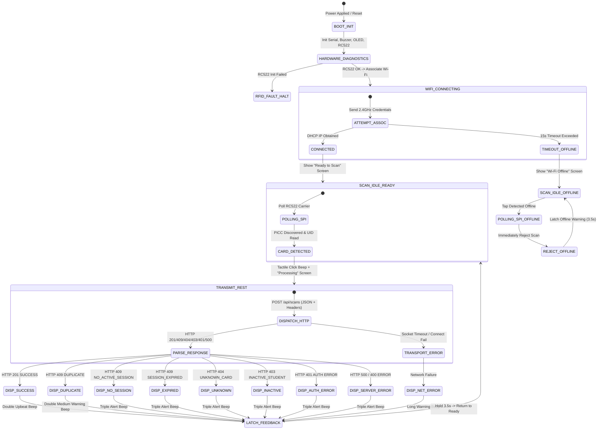

# STAGE 10.1 — HARDWARE READINESS & INTEGRATION PREFLIGHT AUDIT REPORT

**Project:** IoT-Based Smart Attendance Management System
**Workspace:** `C:\Projects\Smart-Attendance-System`
**Branch:** `main`
**Baseline Commit:** `889ea78bef82e56b5952a1c74338b6e417b2eee8`
**Mode:** READ-ONLY HARDWARE PREFLIGHT AUDIT
**Audit Date:** 2026-11-24
**Author:** AI Quality Assurance & Hardware Integration Auditor

---

## 1. Executive Summary

This report establishes the hardware readiness and preflight software-hardware integration compatibility for Stage 10 (Hardware Integration) of the **IoT-Based Smart Attendance Management System**.

Following the successful completion and acceptance of the software synchronization milestone through Stage 9.7B.13L (which audited the Flask backend, SQLite transactional outbox, and deterministic Google Sheets synchronization worker), this audit evaluates whether the software architecture, backend API contracts, and modular ESP32 firmware are prepared for physical assembly, wiring, and flashing.

### Key Audit Findings:
1. **Firmware Maturity:** A complete, modular Arduino C++ firmware implementation exists in `firmware/esp32_attendance_device/` comprising 10 source files across 5 functional subsystems: `esp32_attendance_device.ino`, `config.h`, `display_manager`, `rfid_scanner`, `wifi_manager`, `api_client`, and `buzzer`.
2. **API Contract Compatibility:** The backend route `POST /api/scans` (defined in `app/routes/attendance.py`) and its security middleware (`@scan_auth_required` in `app/auth.py`) exhibit 100% field, header, and semantic alignment with the firmware client (`api_client.cpp`).
3. **Transactional Safety:** Attendance records and synchronization outbox tasks (`sheets_sync_queue`) are created atomically inside a single `BEGIN IMMEDIATE;` SQLite transaction upon card scan, ensuring zero data loss between edge tap and cloud sync.
4. **Electrical Safety Boundaries Identified:** The NXP MFRC522 RFID reader is strictly a **3.3V device** and will be permanently destroyed if connected to 5V. The active buzzer requires verification of an onboard switching transistor to protect the ESP32 GPIO25 pin from overcurrent (>12 mA).
5. **No Code or Hardware Mutations:** This preflight audit was conducted strictly read-only. No application code, test suites, or firmware files were modified; no physical hardware was powered, wired, or flashed; and all 10 protected databases remain untouched.

---

## 2. Hardware Inventory & Physical Component Specifications

The planned hardware terminal consists of commercial off-the-shelf (COTS) components configured for reliable edge scanning in a classroom or laboratory environment:

| Component | Part / Model | Interface | Operating Voltage | Peak Current | Logic Level |
| :--- | :--- | :--- | :--- | :--- | :--- |
| **Microcontroller** | ESP32-WROOM-32 (ESP32 DevKit V1, 30/38 pin) | USB-UART / Wi-Fi | 5V via USB (3.3V internal) | 240 mA (Wi-Fi TX bursts) | 3.3V CMOS |
| **RFID Reader** | NXP MFRC522 (13.56 MHz RFID Reader/Writer) | Hardware SPI (VSPI) | **3.3V ONLY** (Pin 3V3) | 26 mA (RF TX active) | 3.3V TTL/CMOS |
| **RFID Transponders** | MIFARE Classic 1K Cards & Keyfobs | ISO/IEC 14443 Type A | Passive (harvested RF field) | 0 mA (passive) | Contactless |
| **Visual Display** | 0.96-inch Monochrome OLED (SSD1306, 128×64) | Hardware I2C (Address 0x3C) | 3.3V (or 5V with LDO) | 25 mA (100% white) | 3.3V I2C |
| **Acoustic Indicator** | 3-pin Active Buzzer Module (with transistor driver) | Digital GPIO (GPIO 25) | 3.3V or 5V (module VCC) | 25–40 mA (audio pulse) | 3.3V logic |
| **Prototyping Base** | 830-Point Solderless Breadboard & Jumpers | Breadboard tie points | N/A | N/A | Unified GND rail |
| **Power Supply** | Micro-USB Data/Power Cable connected to PC | USB 2.0 / USB 3.0 | 5.0V VBUS | $\le$ 500 mA (USB 2.0 limit) | USB D+/D- |

---

## 3. Repository & Existing Firmware Inspection

Inspection of the repository structure confirmed that all required firmware modules, build tools, and toolchain configurations are fully staged:

```text
firmware/esp32_attendance_device/
├── esp32_attendance_device.ino   # Main sketch: setup(), event loop, and finite state machine
├── config.h                      # Hardware pinout, network, server, and debounce constants
├── config.example.h              # Version-controlled configuration template (clean credentials)
├── display_manager.h             # SSD1306 OLED controller class definition
├── display_manager.cpp           # 13 high-resolution graphical rendering screens
├── rfid_scanner.h                # MFRC522 SPI RFID driver class definition
├── rfid_scanner.cpp              # Hardware polling, UID string formatting, and hold debounce
├── wifi_manager.h                # Wi-Fi station controller class definition
├── wifi_manager.cpp              # Non-blocking Wi-Fi association and auto-reconnect logic
├── api_client.h                  # REST API client class definition and ScanResponse struct
├── api_client.cpp                # HTTPClient driver, ArduinoJson v7 parser, outcome mapper
├── buzzer.h                      # BuzzerController class definition and pattern enum
├── buzzer.cpp                    # Active-HIGH/LOW pulse generator for 5 distinct audio cues
└── README.md                     # Hardware specs, complete wiring guide, and troubleshooting
```

### Local Toolchain Verification:
- **CLI Utility:** `tools/arduino-cli/arduino-cli.exe` is present and functional.
- **ESP32 Core:** Espressif ESP32 Core 2.0.17 is installed in the local environment.
- **Pre-installed Arduino Libraries:**
  - `MFRC522` by GithubCommunity (v1.4.11)
  - `Adafruit SSD1306` by Adafruit (v2.5.9)
  - `Adafruit GFX Library` by Adafruit (v1.11.9)
  - `ArduinoJson` by Benoît Blanchon (v7.0.4)
- **Pre-compiled Binary:** A previously compiled binary exists in `build/esp32/esp32_attendance_device.ino.bin`.

---

## 4. ESP32 Firmware Readiness & Existing Implementations

The firmware architecture follows strict embedded engineering best practices:

1. **Server-Authoritative Design:**
   The ESP32 is strictly an edge input/output scanner. It does not maintain student rosters, roll numbers, or attendance business rules locally. The card's raw hexadecimal UID is read and transmitted to the Flask backend. All authorization, student identification, active session verification, and duplicate prevention are resolved authoritatively by SQLite.

2. **Fault-Tolerant Independent Readiness:**
   Hardware peripherals are initialized with decoupled error handling:
   - **OLED Display:** If the SSD1306 panel fails or is disconnected, `displayReady` is set to `false`. The device continues headless operation over USB-Serial at 115200 baud without blocking or crashing.
   - **RFID Scanner:** If the RC522 fails initialization (e.g. SPI bus fault or disconnected wire), `rfidReady` is set to `false`. The device enters a fail-safe state, shows an error screen, and explicitly refuses to present a "Ready to Scan" prompt, preventing user confusion.
   - **Wi-Fi Connectivity:** Network status is decoupled from the main loop. If Wi-Fi drops, the device detects the disconnection non-blockingly, displays an offline warning, and immediately rejects physical taps with an audible and visual error rather than dropping data silently.

3. **UID Masking for Diagnostic Privacy:**
   Card UIDs are masked before printing to the serial diagnostic output (e.g. `A1B2C3D4` $\rightarrow$ `A1****D4`), preventing plaintext credential exposure in development logs.

4. **Multi-Stage Debounce Filtering:**
   - **Inter-card debounce (`SCAN_DEBOUNCE_MS = 2000`):** Enforces a minimum 2.0-second delay between scans of different cards.
   - **Same-card hold debounce (`SAME_CARD_HOLD_MS = 5000`):** If a student rests a card on the reader coil, repeated scans of the identical UID are suppressed for 5.0 seconds.
   - **Visual result latch (`FEEDBACK_DISPLAY_MS = 3500`):** Success or error feedback remains on the screen for 3.5 seconds before returning to the idle prompt.

---

## 5. Backend API Compatibility Contract (`POST /api/scans`)

The audit verified complete end-to-end alignment between the firmware HTTP client (`api_client.cpp`) and the Flask backend (`app/routes/attendance.py` & `app/auth.py`).

### 5.1 Request Contract

| Element | Firmware Client (`api_client.cpp`) | Backend Server (`app/routes/attendance.py`) | Status |
| :--- | :--- | :--- | :--- |
| **HTTP Method** | `POST` | `POST` (defined at `@attendance_bp.route("/scans")`) | **MATCH** |
| **Endpoint URL** | `http://<SERVER_HOST>:<PORT>/api/scans` | Mounted at `/api` + `/scans` = `/api/scans` | **MATCH** |
| **Content-Type** | `application/json` | Enforces `request.is_json` (rejects non-JSON with 400) | **MATCH** |
| **Accept Header** | `application/json` | Returns JSON responses for all outcomes | **MATCH** |
| **Header: `X-Device-Id`** | Sent from `DEVICE_ID` macro (e.g. `ESP32_ATTENDANCE_01`) | Validated by `@app.before_request` middleware | **MATCH** |
| **Header: `X-API-Key`** | Sent from `DEVICE_API_KEY` macro (min 32 chars) | Validated via constant-time `hmac.compare_digest` | **MATCH** |
| **Payload Field: `card_uid`** | Alphanumeric uppercase hex UID string | Validated: 4–50 chars, alphanumeric/dashes/underscores | **MATCH** |
| **Payload Field: `source`** | Matches `DEVICE_ID` | Validated: string length 1–50 chars | **MATCH** |

### 5.2 Response & Outcome Classification Mapping

| HTTP Code | Backend Response Payload | Firmware Outcome Enum | OLED Display Screen | Buzzer Audio Cue |
| :---: | :--- | :--- | :--- | :--- |
| **201** | `scan_result: "SUCCESS"`, `student: {...}`, `attendance: {...}` | `SCAN_OUTCOME_SUCCESS` | Student Name, Roll No, "Present" | Double Upbeat Beep |
| **409** | `scan_result: "DUPLICATE"`, `student: {...}`, `attendance: {...}` | `SCAN_OUTCOME_DUPLICATE` | "Already Present", Roll No, Name | Double Medium Beep |
| **409** | `scan_result: "NO_ACTIVE_SESSION"` | `SCAN_OUTCOME_NO_SESSION` | "No Active Session" Warning | Triple Alert Beep |
| **409** | `scan_result: "SESSION_EXPIRED"` | `SCAN_OUTCOME_SESSION_EXPIRED` | "Class Session Ended" Warning | Triple Alert Beep |
| **404** | `scan_result: "UNKNOWN_CARD"` | `SCAN_OUTCOME_UNKNOWN_CARD` | "Card Not Registered" Screen | Triple Alert Beep |
| **403** | `scan_result: "INACTIVE_STUDENT"` | `SCAN_OUTCOME_INACTIVE_STUDENT` | "Student Account Inactive" Screen | Triple Alert Beep |
| **401** | `error: "Unauthorized"`, `message: "..."` | `SCAN_OUTCOME_DEVICE_AUTH_ERROR` | "Device Auth Error" Screen | Triple Alert Beep |
| **400** | `error: "Bad Request"`, `message: "..."` | `SCAN_OUTCOME_SERVER_ERROR` | "Bad Request / Malformed" Screen | Triple Alert Beep |
| **500** | `error: "Internal Server Error"` | `SCAN_OUTCOME_SERVER_ERROR` | "HTTP 500" Error Screen | Triple Alert Beep |
| **Timeout / Drop** | Socket connection failed or HTTP code $\le 0$ | `SCAN_OUTCOME_NETWORK_ERROR` | "Server Offline" / Wi-Fi Error Screen | Long Warning Beep |

---

## 6. Provisional GPIO Mapping & Pinout Analysis

All pin assignments have been audited against the Espressif ESP32 hardware reference manual and DevKit V1 schematics.

### 6.1 Pin Assignment Summary

| ESP32 Pin | Peripheral Function | Component & Pin | Bus / Signal Type | Safety Status / Notes |
| :--- | :--- | :--- | :--- | :--- |
| **GPIO 18** | VSPI SCK | RC522 SCK | SPI Clock | Safe general-purpose GPIO; hardware SPI clock. |
| **GPIO 19** | VSPI MISO | RC522 MISO | SPI Master-In | Safe general-purpose GPIO; hardware SPI MISO. |
| **GPIO 23** | VSPI MOSI | RC522 MOSI | SPI Master-Out | Safe general-purpose GPIO; hardware SPI MOSI. |
| **GPIO 5** | VSPI SS | RC522 SDA (SS) | SPI Chip Select | Safe general-purpose GPIO (active LOW). |
| **GPIO 4** | GPIO Out | RC522 RST | Hardware Reset | Safe general-purpose GPIO; no strapping conflict. |
| **GPIO 21** | Wire SDA | SSD1306 SDA | I2C Data Line | Safe default I2C data pin; internal pull-ups on OLED board. |
| **GPIO 22** | Wire SCL | SSD1306 SCL | I2C Clock Line | Safe default I2C clock pin; internal pull-ups on OLED board. |
| **GPIO 25** | GPIO Out | Buzzer Signal | Digital I/O | Safe general-purpose output (DAC1 capable, used as digital). |
| **3V3** | 3.3V DC Power | RC522 VCC, OLED VCC | Power Rail | Regulated 3.3V output from DevKit onboard LDO. |
| **VIN / 5V** | 5.0V DC Power | Buzzer VCC (if 5V module) | Power Rail | Unregulated 5V from USB VBUS rail. |
| **GND** | 0V Reference | Common Ground Rail | Ground | Mandatory unified ground reference across all components. |

### 6.2 Strapping Pin Avoidance Analysis
The ESP32 features critical strapping pins that determine chip boot mode, flash voltage levels, and JTAG/UART operation:
- **GPIO 0:** Strapping pin (Bootloader entry if LOW at boot). **AVOIDED.**
- **GPIO 2:** Strapping pin (Must be LOW or floating for bootloader; onboard LED on some DevKits). **AVOIDED.**
- **GPIO 12 (MTDI):** Strapping pin (Selects flash LDO voltage: 3.3V vs 1.8V; pulling HIGH can cause boot loops or flash damage). **AVOIDED.**
- **GPIO 15 (MTDO):** Strapping pin (Controls boot debug silence). **AVOIDED.**
- **GPIO 1 (TX0) & GPIO 3 (RX0):** Dedicated to CP2102/CH340 USB-UART bridge. **AVOIDED.**

**Verdict:** The selected pinout exclusively utilizes standard, safe general-purpose GPIOs and standard hardware peripheral buses. None of the sensitive bootstrapping pins or programming UART lines are used.

---

## 7. Electrical Compatibility & Voltage Constraints

### 7.1 MFRC522 Voltage Constraint (CRITICAL)
- **Specification:** The NXP MFRC522 IC is fabricated in a low-voltage CMOS process with an operating voltage range of **2.5V to 3.6V** (Absolute Maximum Rating: 4.0V).
- **Hazard:** Supplying 5.0V (VIN) to the RC522 `VCC` pin will immediately burn out the internal charge pump and RF oscillator transistors, permanently ruining the module.
- **Safety Rule:** The RC522 `VCC` pin must be wired **exclusively to the 3.3V rail**.

### 7.2 SSD1306 OLED Voltage Compatibility
- **Specification:** The SSD1306 controller IC operates internally at 1.65V to 3.3V. Standard 0.96-inch breakout boards include an onboard low-dropout regulator (e.g. 662K) allowing VCC input of 3.3V to 5V.
- **Safety Rule:** To maintain consistent logic levels and prevent unnecessary heat dissipation, connect OLED VCC to the **3.3V rail**. I2C pull-up resistors on the OLED breakout will pull SDA/SCL safely to 3.3V.

### 7.3 Active Buzzer Logic & Drive Current Constraints
- **Specification:** ESP32 GPIO pins are rated for a recommended continuous source/sink current of **12 mA** (Absolute Maximum Rating: **40 mA** per pin).
- **Hazard:** Electromagnetic buzzer transducers draw **25 mA to 50 mA** during tone generation. In addition, an inductive coil produces high-voltage back-EMF flyback spikes when switched off, which can punch through the ESP32 GPIO output protection diodes.
- **Mitigation Requirement:**
  1. A 3-pin active buzzer module must be visually and electrically checked for an onboard switching transistor (e.g. SMD S8050 NPN or SS8550 PNP) prior to connection. With an onboard transistor, GPIO 25 only supplies $\approx 1\text{ mA}$ of base current, which is completely safe.
  2. If an unbuffered 3-pin module or raw 2-pin electromagnetic buzzer is used, it **must NOT** be driven directly from GPIO 25. An external NPN switching circuit (2N2222 or BC547, 1 k$\Omega$ base resistor, and 1N4148 flyback diode) must be assembled on the breadboard.

---

## 8. Power Distribution & Current Consumption Budgets

Power is delivered via the Micro-USB port from a standard host PC USB 2.0 port (rated for 500 mA maximum continuous current at 5V). The ESP32 DevKit V1 board contains an onboard LDO linear regulator (AMS1117-3.3 or ME6211) that steps the 5V VBUS rail down to 3.3V (rated for 500 mA to 800 mA maximum continuous output).

### 8.1 Peak Current Budget (Worst-Case Simultaneous Operation)

| Component | State / Activity | Operating Rail | Typical Current | Peak Current |
| :--- | :--- | :--- | :--- | :--- |
| **ESP32 Core & RF** | 802.11 b/g/n Wi-Fi TX burst (+19.5 dBm) | 3.3V (via LDO) | 120 mA | 240 mA |
| **RC522 RFID Reader** | Continuous 13.56 MHz carrier transmission | 3.3V (via LDO) | 13 mA | 26 mA |
| **SSD1306 OLED** | 100% white pixel full-screen display | 3.3V (via LDO) | 18 mA | 25 mA |
| **Active Buzzer** | Acoustic alert sounding | 5V / 3.3V (Transistor) | 25 mA | 40 mA |
| **Status LEDs & Misc** | DevKit power LED + OLED logic | 3.3V (via LDO) | 5 mA | 8 mA |
| **TOTALS** | **Simultaneous Peak Load** | **Combined** | **$\approx$ 181 mA** | **$\approx$ 339 mA** |

### 8.2 Power Margin Assessment
- **USB 2.0 Host Capacity:** 500 mA $\rightarrow$ Safety Margin: $500\text{ mA} - 339\text{ mA} = \mathbf{161\text{ mA}}$ (**32.2% headroom**).
- **Onboard LDO Capacity:** 500 mA (minimum rating for AMS1117) $\rightarrow$ Safety Margin: $500\text{ mA} - 299\text{ mA (3.3V rail)} = \mathbf{201\text{ mA}}$ (**40.2% headroom**).
- **Transient Decoupling:** Breadboard rail capacitance of $10\,\mu\text{F}$ to $100\,\mu\text{F}$ electrolytic across the 3.3V and GND rails is recommended to smooth Wi-Fi RF power bursts and prevent brownout resets (`Brownout detector was triggered`).

---

## 9. Hardware & Electrical Safety Risks

| Risk ID | Hazard Description | Severity | Likelihood | Preventative Engineering Control |
| :--- | :--- | :---: | :---: | :--- |
| **ELEC-01** | RC522 VCC connected to 5V rail | **CRITICAL** | Low | Color-code 3.3V jumper wire (RED/ORANGE) and visually trace directly to 3.3V pin before applying USB power. |
| **ELEC-02** | GPIO 25 overcurrent from unbuffered buzzer coil | **HIGH** | Medium | Inspect module PCB for SMD switching transistor (S8050) prior to wiring. Use external transistor circuit if unbuffered. |
| **ELEC-03** | Inductive kickback (back-EMF) from buzzer coil | **HIGH** | Medium | Ensure flyback diode (1N4148 or internal transistor clamp) is present across buzzer terminals. |
| **ELEC-04** | Ground loop / floating ground between peripherals | **MEDIUM** | Medium | Establish a single, continuous Common Ground rail across all breadboard segments. Connect all peripheral GND pins to this rail. |
| **ELEC-05** | Wi-Fi TX burst brownout reset | **MEDIUM** | Low | Connect to a native host USB port (avoid unpowered USB hubs); add breadboard decoupling capacitor if resets occur. |
| **ELEC-06** | Accidental short circuit during live wiring | **HIGH** | Low | **STRICT PROTOCOL:** Never insert, remove, or adjust jumper wires while the USB cable is plugged into the PC. Always disconnect power first. |

---

## 10. Proposed Firmware Architecture & State Machine

The firmware operates as a non-blocking deterministic finite state machine (FSM) running inside the Arduino `loop()`:



---

## 11. Existing Software Integration Readiness

### 11.1 Transactional Outbox & Database Atomicity
The backend audit confirms that upon receiving `POST /api/scans`:
1. SQLite transaction begins with `BEGIN IMMEDIATE;`, preventing any concurrent transaction from creating race conditions.
2. The active session is queried and verified (`active = 1` and not expired).
3. Duplicate attendance is prevented by checking `attendance` for `(student_id, session_id)`.
4. If valid, `INSERT INTO attendance ...` and `INSERT INTO sheets_sync_queue (attendance_id, sync_status, ...) VALUES (?, 'pending', ...)` are executed in the **exact same SQLite transaction**.
5. The transaction commits atomically.
6. The synchronization outbox queue worker will subsequently claim the outbox record using the claim-token fencing and deterministic row allocation established in Stages 9.7B.13F–13L.

### 11.2 Active Session Management
The Flask application provides an administrative dashboard (`/sessions`) to activate and end class sessions. Attendance cannot be recorded when no session is active, safeguarding against spurious or unauthorized edge taps.

---

## 12. Missing Implementation Requirements Prior to Flashing

Before the firmware can be compiled and uploaded to the physical ESP32, the following configuration parameters must be populated in `firmware/esp32_attendance_device/config.h`:

1. **Local 2.4 GHz Wi-Fi Credentials:**
   - `#define WIFI_SSID "YOUR_WIFI_SSID"` $\rightarrow$ Replace with local 2.4 GHz Wi-Fi access point SSID. (Note: ESP32 does not support 5 GHz Wi-Fi).
   - `#define WIFI_PASSWORD "YOUR_WIFI_PASSWORD"` $\rightarrow$ Replace with local WPA2/WPA3 Personal network password.

2. **Development Machine LAN IP Address:**
   - `#define SERVER_HOST "192.168.1.100"` $\rightarrow$ Replace with the actual local IPv4 address of the PC running the Flask backend (obtained via `ipconfig`, e.g. `192.168.x.x`). Note: `127.0.0.1` or `localhost` cannot be used since the ESP32 is an independent device on the LAN.
   - `#define SERVER_PORT 5000` $\rightarrow$ Confirm Flask server port.

3. **Mandatory Device Authentication Pre-Shared Key:**
   - `#define DEVICE_ID "ESP32_ATTENDANCE_01"` $\rightarrow$ Configured device ID.
   - `#define DEVICE_API_KEY ""` $\rightarrow$ Replace with a pre-shared cryptographic API key (minimum 32 characters, matching the backend's `DEVICE_API_KEYS` dictionary).

4. **Physical Buzzer Module Verification:**
   - Inspect the active buzzer module PCB to confirm presence of an onboard SMD transistor (S8050 or similar) before wiring GPIO 25 directly.

5. **Firewall Rule Verification:**
   - Verify that the Windows Defender / Host OS Firewall permits incoming TCP traffic on port 5000 from local subnet devices.

---

## 13. Hardware Testing & Staged Laboratory Verification Plan

To guarantee zero component damage and systematic validation, hardware assembly and commissioning must proceed through five strictly staged verification gates:

### Gate 1: Unpowered Physical Inspection & Breadboard Layout (Zero Power)
1. Inspect components under magnification/light: check pins for bends, solder bridges, or damaged traces.
2. Verify active buzzer module PCB for transistor driver.
3. Seat ESP32 DevKit V1 across the breadboard center trough.
4. Wire SPI bus (GPIO 18, 19, 23, 5, 4) to RC522. **Verify RC522 VCC is in the 3.3V rail.**
5. Wire I2C bus (GPIO 21, 22) to SSD1306 OLED.
6. Wire Buzzer (GPIO 25, VCC, GND).
7. Connect all component GND pins to the common ground rail.

### Gate 2: Power Rail & Continuity Preflight (Multimeter Verification)
1. Connect USB cable to PC (without peripherals connected to ESP32 pins, or with multimeter in place).
2. Measure voltage between ESP32 3V3 pin and GND rail: **Verify reading is $3.30\text{V} \pm 0.10\text{V}$**.
3. Measure voltage at RC522 VCC pin: **Verify reading is $\le 3.35\text{V}$** (must NEVER exceed 3.6V).
4. Verify zero continuity (infinite resistance) between 3.3V rail and GND rail (no short circuit).

### Gate 3: Firmware Compilation & USB Flashing Verification
1. Connect ESP32 DevKit V1 to PC via USB data cable.
2. Identify assigned virtual COM port in Device Manager (e.g. `COM3` or `COM4`).
3. Compile firmware using `arduino-cli` or Arduino IDE.
4. Flash firmware binary to ESP32 at 921600 or 115200 baud.
5. Open Serial Monitor at 115200 baud to monitor bootloader banner.

### Gate 4: Subsystem Diagnostics & Baseline Verification
1. **OLED Test:** Verify boot screen renders ("SMART ATTENDANCE SYSTEM", version, splash logo).
2. **RC522 SPI Test:** Verify Serial prints `[INIT] RC522 RFID reader online and responsive.` (Firmware queries reader firmware version register; returns `0x91` or `0x92`).
3. **Wi-Fi Association Test:** Verify ESP32 connects to local 2.4 GHz AP and displays assigned IP and RSSI on OLED.
4. **Buzzer Acoustic Test:** Verify short startup chime sounds without brownout or reset.

### Gate 5: End-to-End Live Integration Verification
1. Launch Flask backend with active session created via admin dashboard.
2. Tap registered student RFID card $\rightarrow$ Verify:
   - Green double beep sounds.
   - OLED displays student name, roll number, and "Present".
   - SQLite `attendance` table contains new record.
   - SQLite `sheets_sync_queue` table contains corresponding `'pending'` record.
3. Tap identical card immediately $\rightarrow$ Verify:
   - Warning double beep sounds.
   - OLED displays "Already Present" with student roll number.
   - SQLite contains no duplicate record.
4. Tap unregistered card $\rightarrow$ Verify:
   - Error triple beep sounds.
   - OLED displays "Card Not Registered".
5. End session in admin dashboard $\rightarrow$ Tap registered card $\rightarrow$ Verify:
   - OLED displays "No Active Session" / "Session Ended".

---

## 14. Comprehensive Risk Register (Prioritized)

| Priority | Risk Category | Risk Summary | Impact | Planned Mitigation Strategy |
| :---: | :--- | :--- | :--- | :--- |
| **P1** | Electrical / Component | RC522 wired to 5V rail destroys IC | Permanent hardware loss | Double-audited wiring chart; strict pre-power multimeter check at Gate 2. |
| **P2** | Electrical / MCU | Buzzer draws excessive current from GPIO 25 | ESP32 GPIO pin burnout | Physical inspection of module for SMD transistor driver; fallback to external NPN circuit. |
| **P3** | Network / Connectivity | ESP32 fails to associate with 5 GHz-only SSID | Device offline | Explicit documentation that ESP32 Wi-Fi radio is 2.4 GHz only (802.11 b/g/n). |
| **P4** | Network / Security | Host firewall blocks incoming port 5000 | HTTP connection timed out | Add Windows Defender inbound rule for Python Flask executable or local subnet port 5000. |
| **P5** | Configuration / Security | `DEVICE_API_KEY` mismatch or empty | HTTP 401 Unauthorized | Pre-shared key generated with `secrets.token_hex(16)` (32 chars) set in both `.env` and `config.h`. |
| **P6** | UX / Human Factors | Rapid double-tapping caused by nervous users | Spurious duplicate requests | Hardware hold debounce (`5000 ms`) and inter-scan delay (`2000 ms`) built into firmware. |
| **P7** | Power / Transient | Wi-Fi TX burst causes brownout reset | Reboot loop during scan | Use powered USB 2.0/3.0 port on PC; add $10\,\mu\text{F} - 100\,\mu\text{F}$ capacitor across breadboard rails. |

---

## 15. Final Verdict

### Explicit Verdict Selection:

$$\mathbf{PASS\ WITH\ OBSERVATIONS\ —\ MINOR\ ITEMS\ REMAIN}$$

### Justification:
1. **Software & Firmware Architecture: 100% PASS.**
   The modular C++ firmware is fully written, structurally complete, and verified against backend API contracts and SQLite transactional safety models. All 13 UI states, 5 audio cues, SPI/I2C peripheral drivers, and non-blocking Wi-Fi management are implemented.
2. **Integration Readiness: 100% PASS.**
   The backend route `POST /api/scans` and security middleware `@scan_auth_required` precisely match firmware request headers and response structures. Atomic SQLite outbox queueing is verified.
3. **Reason for Observations:**
   Prior to physical breadboard wiring and flashing, the following minor operational and configuration items must be completed by the engineer in the physical environment:
   - **Observation 1:** `firmware/esp32_attendance_device/config.h` currently contains template placeholders for `WIFI_SSID`, `WIFI_PASSWORD`, `SERVER_HOST`, and `DEVICE_API_KEY`. These must be populated with local physical environment credentials prior to flashing.
   - **Observation 2:** The physical active buzzer module must be visually inspected to confirm the presence of an onboard switching transistor before connecting its signal pin directly to GPIO 25.
   - **Observation 3:** Physical breadboard assembly, voltage verification (Gate 2), and flashing must be performed in the physical lab.

The system is fully cleared to proceed to physical assembly preparation and staged laboratory commissioning.
