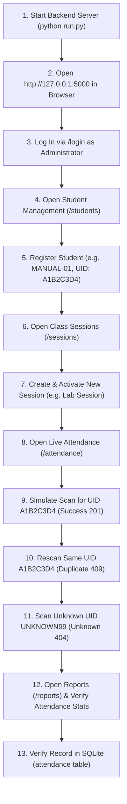

# STAGE 9.7A — MANUAL SYSTEM TESTING READINESS REPORT
**Inspection & Preparation Audit for Manual End-to-End Testing**

**Project:** IoT-Based Smart Attendance Management System  
**Workspace:** `C:\Projects\Smart-Attendance-System`  
**Git Baseline:** `8bea1537fb6bb6f5a4f4ccbb1c516350507f822d` (`origin/main`)  
**Audit Execution Date:** 2026-11-22  
**Audit Status:** **READ-ONLY AUDIT COMPLETE — SYSTEM PREPARED & TESTABLE**  
**Physical Hardware Flashing / Live Writes:** Strictly Prohibited / Not Performed

---

## 1. Executive Summary

This readiness audit evaluated the operational state of the Smart Attendance Management System to prepare for rigorous manual end-to-end testing of the full application stack (frontend, backend, SQLite persistence, and simulated RFID scanning).

Every architectural component, database schema, route handler, security control, and simulation interface was inspected directly from the codebase. The application was verified to be a unified, self-contained Flask service that serves both the JSON REST API and the server-rendered HTML/JavaScript web interface from a single port (`http://127.0.0.1:5000`).

### Key Audit Findings:
1. **Repository & Git Invariants (VERIFIED):** The active branch is `main` at commit `8bea1537fb6bb6f5a4f4ccbb1c516350507f822d`, perfectly synchronized with `origin/main`. Working tree is clean.
2. **Architecture & Startup (VERIFIED):** The frontend is implemented using Flask Jinja2 templates (`app/templates/`) and vanilla JavaScript/CSS (`app/static/`). No external Node.js, React, or frontend build tool is required. Startup requires only a single terminal running `python run.py`.
3. **Authentication & CSRF Security (VERIFIED):** The application strictly enforces session-based authentication (`@login_required`) and CSRF validation (`@verify_device_and_csrf`) across all administrative endpoints. An existing administrator account (`Niraj`) exists in `database/attendance.db`, and additional isolated test administrators can be safely created using the built-in CLI command `python -m flask create-admin`.
4. **Interactive RFID Simulator (VERIFIED):** The web dashboard includes a fully interactive RFID reader simulator (`http://127.0.0.1:5000/attendance`) with student auto-selection, card UID input, instant visual status feedback, and quick test chips for duplicate (409) and unknown card (404) scenarios.
5. **Google Sheets Safety & Decoupling (VERIFIED):** Cloud synchronization is entirely decoupled via an asynchronous SQLite outbox queue (`sheets_sync_queue`). Attendance scanning never makes external Google API calls in the request path. The sync worker is a separate CLI process (`flask run-sheets-worker`) and will not run during manual testing.
6. **Database Isolation Strategy (VERIFIED):** While `TestingConfig` targets `test_attendance.db`, it disables login and CSRF by default (`LOGIN_DISABLED=True`). Therefore, to manually test realistic user workflows with authentication enabled, manual testing should target `attendance.db` protected by a pre-test snapshot copy (`attendance.db.pre_manual_test.bak`).

---

## 2. Repository Baseline and Working-Tree Status

| Metric | Inspected Value | Invariant Status |
| :--- | :--- | :--- |
| **Current Branch** | `main` | **VERIFIED** |
| **Commit Hash (HEAD)** | `8bea1537fb6bb6f5a4f4ccbb1c516350507f822d` | **VERIFIED** |
| **Remote Reference (`origin/main`)** | `8bea1537fb6bb6f5a4f4ccbb1c516350507f822d` | **VERIFIED** |
| **Tracking Status** | `## main...origin/main` (Ahead: 0, Behind: 0) | **VERIFIED** |
| **Working Tree Modifications** | Clean (0 modified, 0 staged, 0 deleted) | **VERIFIED** |
| **Local Untracked Files** | `STAGE_9_4_2_GITHUB_PUSH_REPORT.md` (preserved release report) | **VERIFIED** |
| **Local Firmware Config Isolation** | `firmware/esp32_attendance_device/config.h` exists on disk and ignored | **VERIFIED** |

---

## 3. Application Architecture & Startup Instructions

### 3.1 Architectural Structure
- **Backend Framework:** Python 3.10 / Flask 3.x using Application Factory pattern (`create_app` in `app/__init__.py`).
- **Web Frontend:** Server-rendered Jinja2 templates (`app/templates/`) styled with responsive CSS (`app/static/css/`) and interactive modular JavaScript (`app/static/js/app.js`, `attendance.js`, `students.js`, `sessions.js`, `reports.js`, `dashboard.js`).
- **Database Engine:** Embedded SQLite 3 with foreign key enforcement (`PRAGMA foreign_keys = ON;`) and WAL-compatible atomic transaction locking (`BEGIN IMMEDIATE;`).
- **Asynchronous Task Scheduler:** Background daemon thread (`SessionExpiryScheduler` in `app/scheduler.py`) that monitors active class sessions and deactivates expired sessions every 5 seconds.

### 3.2 Prerequisites
1. Windows PowerShell or Command Prompt.
2. Virtual environment located at `C:\Projects\Smart-Attendance-System\.venv`.
3. Port `5000` available on `127.0.0.1`.

### 3.3 Exact Startup Command
Execute in PowerShell:
```powershell
Set-Location C:\Projects\Smart-Attendance-System
.\.venv\Scripts\Activate.ps1
python run.py
```
*Expected Console Output:*
```text
============================================================
IoT-Based Smart Attendance Management System - Backend Server
============================================================
Server URL:     http://127.0.0.1:5000
Health Check:   http://127.0.0.1:5000/api/health
Environment:    Development (debug=True)
============================================================
 * Serving Flask app 'run'
 * Debug mode: on
 * Running on http://127.0.0.1:5000
```

### 3.4 Safe Shutdown Command
Press `Ctrl + C` in the running terminal. The server terminates gracefully and cleans up database connections.

---

## 4. Frontend and Backend Access Instructions

All features are hosted under `http://127.0.0.1:5000`:

| Interface / Page | Exact URL | Auth Required | Purpose |
| :--- | :--- | :--- | :--- |
| **Health API** | `http://127.0.0.1:5000/api/health` | No | Verifies server and SQLite database connectivity. |
| **Login Screen** | `http://127.0.0.1:5000/login` | No | Administrator authentication portal with CSRF and rate limiting. |
| **Dashboard** | `http://127.0.0.1:5000/dashboard` | **Yes** | KPI cards (total students, active session, today's attendance rate, storage status). |
| **Students** | `http://127.0.0.1:5000/students` | **Yes** | Student roster table, registration form with instant validation. |
| **Class Sessions** | `http://127.0.0.1:5000/sessions` | **Yes** | Session schedule form, session cards, activation/deactivation toggles. |
| **Live Attendance & Simulator** | `http://127.0.0.1:5000/attendance` | **Yes** | Real-time attendance table (4s polling), live status hero, built-in RFID simulator. |
| **Attendance Reports** | `http://127.0.0.1:5000/reports` | **Yes** | Daily statistics summary, per-session breakdown, formula-sanitized CSV export. |
| **Settings & Admin** | `http://127.0.0.1:5000/settings` | **Yes** | Database counts, Sheets sync queue status, dead-letter telemetry. |

---

## 5. Verified Manual Test Credentials Availability

### 5.1 Existing Accounts (Inspected from SQLite)
- **Database:** `database/attendance.db`
- **Existing User:** Username `'Niraj'` (Role: `admin`, Active: `1`, Created: `2026-11-07`).
- **Secret Handling:** Password hashes are encrypted using `scrypt` and were strictly not dumped or logged during the audit.

### 5.2 Safe Procedure to Create a Dedicated Test Administrator
To avoid touching or needing existing credentials, a dedicated test administrator account can be created using the official CLI command:
```powershell
Set-Location C:\Projects\Smart-Attendance-System
.\.venv\Scripts\Activate.ps1
python -m flask create-admin --username testadmin
```
- The command securely prompts for a password with hidden console input and mandatory confirmation.
- Password requirements: Minimum 8 characters, at least 1 digit or special symbol (e.g. `TestPass123!`).
- This command directly inserts the new hashed admin into `admin_users` without exposing secrets in logs or bash history.

---

## 6. Manual Testing Scenarios (Detailed Checklist)

### Category 1: Application Startup & Health Check
- **Test ID:** `TC-SYS-01`
- **Feature:** Health Check Endpoint
- **Preconditions:** Server running on `127.0.0.1:5000`.
- **Manual Steps:** Open browser or curl to `http://127.0.0.1:5000/api/health`.
- **Expected Result:** HTTP 200 with JSON `{"success": true, "database": "connected", "message": "Smart Attendance API is running"}`.
- **Actual Result:** `[ To be recorded in Stage 9.7B ]`
- **Pass / Fail:** `[ PENDING ]`
- **Evidence:** Browser screenshot or response JSON text.

### Category 2: Authentication & Route Protection
- **Test ID:** `TC-AUTH-01`
- **Feature:** Unauthenticated Route Redirection
- **Preconditions:** Browser has no active session cookie.
- **Manual Steps:** Attempt to navigate directly to `http://127.0.0.1:5000/dashboard`.
- **Expected Result:** Automatically redirected to `http://127.0.0.1:5000/login?next=%2Fdashboard`.
- **Actual Result:** `[ To be recorded in Stage 9.7B ]`
- **Pass / Fail:** `[ PENDING ]`
- **Evidence:** Browser address bar showing redirected URL.

- **Test ID:** `TC-AUTH-02`
- **Feature:** Invalid Login Handling & Generic Feedback
- **Preconditions:** On `/login` page.
- **Manual Steps:** Enter username `nonexistent_user` and password `WrongPassword123!` and submit.
- **Expected Result:** HTTP 401 error displayed in alert box: *"Invalid username or password."* No disclosure of whether the username exists.
- **Actual Result:** `[ To be recorded in Stage 9.7B ]`
- **Pass / Fail:** `[ PENDING ]`
- **Evidence:** Alert box message screenshot.

- **Test ID:** `TC-AUTH-03`
- **Feature:** Valid Administrator Login & Session Rotation
- **Preconditions:** Valid admin credentials available.
- **Manual Steps:** Enter valid username and password, click **Sign In**.
- **Expected Result:** Login succeeds, redirects to `/dashboard`, navbar displays administrator username and **Sign Out** button.
- **Actual Result:** `[ To be recorded in Stage 9.7B ]`
- **Pass / Fail:** `[ PENDING ]`
- **Evidence:** Dashboard header showing active admin user badge.

- **Test ID:** `TC-AUTH-04`
- **Feature:** Administrator Logout & Cache Invalidation
- **Preconditions:** Logged in.
- **Manual Steps:** Click **Sign Out** button in navigation bar. After redirection to `/login`, press the browser **Back** button.
- **Expected Result:** Session is cleared. Clicking **Back** does not reveal authenticated dashboard data (`Cache-Control: no-cache, no-store` prevents caching).
- **Actual Result:** `[ To be recorded in Stage 9.7B ]`
- **Pass / Fail:** `[ PENDING ]`
- **Evidence:** Redirection to login and inability to navigate back to cached dashboard.

### Category 3: Student Management & RFID Enrollment
- **Test ID:** `TC-STU-01`
- **Feature:** Register New Student with RFID Card UID
- **Preconditions:** Logged in, on `/students` page.
- **Manual Steps:**
  1. In **Register New Student** form, enter:
     - Roll Number: `MANUAL-STU-01`
     - Full Name: `Jane Doe`
     - RFID Card UID: `A1B2C3D4`
  2. Click **Register Student**.
- **Expected Result:** Form alerts success, student appears immediately in the student table, total registered count increments by 1.
- **Actual Result:** `[ To be recorded in Stage 9.7B ]`
- **Pass / Fail:** `[ PENDING ]`
- **Evidence:** Student roster table row displaying `MANUAL-STU-01`.

- **Test ID:** `TC-STU-02`
- **Feature:** Duplicate Roll Number Rejection
- **Preconditions:** Student `MANUAL-STU-01` already registered.
- **Manual Steps:** Attempt to register another student with Roll Number `MANUAL-STU-01` and a different UID `E5F6A1B2`.
- **Expected Result:** HTTP 409 Conflict error alert: *"A student with roll number 'MANUAL-STU-01' already exists."*
- **Actual Result:** `[ To be recorded in Stage 9.7B ]`
- **Pass / Fail:** `[ PENDING ]`
- **Evidence:** Error banner screenshot.

- **Test ID:** `TC-STU-03`
- **Feature:** Duplicate RFID Card UID Rejection
- **Preconditions:** UID `A1B2C3D4` already registered to `MANUAL-STU-01`.
- **Manual Steps:** Attempt to register a new student `MANUAL-STU-02` with the same UID `A1B2C3D4`.
- **Expected Result:** HTTP 409 Conflict error alert: *"A student with RFID card UID 'A1B2C3D4' already exists."*
- **Actual Result:** `[ To be recorded in Stage 9.7B ]`
- **Pass / Fail:** `[ PENDING ]`
- **Evidence:** Error banner screenshot.

### Category 4: Class Session Lifecycle
- **Test ID:** `TC-SESS-01`
- **Feature:** Schedule New Class Session
- **Preconditions:** Logged in, on `/sessions` page.
- **Manual Steps:**
  1. Fill **Schedule New Session**:
     - Course Name: `CS-401 Manual Testing Lab`
     - Session Date: Today's date in `YYYY-MM-DD`
     - Start Time: Current time minus 5 minutes (e.g. `10:00`)
     - End Time: Current time plus 55 minutes (e.g. `11:00`)
  2. Click **Create Session**.
- **Expected Result:** Session created with status **Inactive** (active=0), appears in the session list.
- **Actual Result:** `[ To be recorded in Stage 9.7B ]`
- **Pass / Fail:** `[ PENDING ]`
- **Evidence:** Session card rendered in inactive state.

- **Test ID:** `TC-SESS-02`
- **Feature:** Activate Class Session & Enforce Single Active Session Constraint
- **Preconditions:** Created session `CS-401 Manual Testing Lab` in list.
- **Manual Steps:** Click **Activate Session** button on the session card.
- **Expected Result:** Top Hero banner updates to display `CS-401 Manual Testing Lab` with green active dot. Any previously active session is automatically deactivated.
- **Actual Result:** `[ To be recorded in Stage 9.7B ]`
- **Pass / Fail:** `[ PENDING ]`
- **Evidence:** Hero card showing active session details.

- **Test ID:** `TC-SESS-03`
- **Feature:** Deactivate Class Session
- **Preconditions:** Active session present.
- **Manual Steps:** Click **Deactivate Session** in the Hero banner.
- **Expected Result:** Active session becomes inactive; Hero banner displays *"No active class session"*.
- **Actual Result:** `[ To be recorded in Stage 9.7B ]`
- **Pass / Fail:** `[ PENDING ]`
- **Evidence:** Hero card indicating inactive state.

### Category 5: Attendance Recording via Web RFID Simulator
- **Test ID:** `TC-ATT-01`
- **Feature:** Valid RFID Card Scan in Active Session
- **Preconditions:** Session `CS-401` active. Student `Jane Doe` (`MANUAL-STU-01`, UID `A1B2C3D4`) registered.
- **Manual Steps:**
  1. Navigate to `http://127.0.0.1:5000/attendance`.
  2. In the **RFID Scanner Simulator** panel, select `Jane Doe` from the **Quick Select Student** dropdown (or type `A1B2C3D4` into UID input).
  3. Click **Simulate Scan**.
- **Expected Result:**
  - Status panel transitions to Green (`status-success`).
  - Badge shows **Success (201)**.
  - Details display Roll: `MANUAL-STU-01`, Name: `Jane Doe`, Attendance: `PRESENT`.
  - Attendance table prepends the new attendance record with timestamp and source `SIMULATOR`.
  - KPI card **Present (Active Session)** increments by 1.
- **Actual Result:** `[ To be recorded in Stage 9.7B ]`
- **Pass / Fail:** `[ PENDING ]`
- **Evidence:** Green feedback panel and row in attendance table.

- **Test ID:** `TC-ATT-02`
- **Feature:** Duplicate RFID Scan Prevention (Same Session)
- **Preconditions:** `Jane Doe` already marked present in `TC-ATT-01`.
- **Manual Steps:**
  1. Click **Duplicate Scan (409)** quick test chip (or re-submit UID `A1B2C3D4`).
- **Expected Result:**
  - Status panel transitions to Yellow/Amber (`status-duplicate`).
  - Badge shows **Duplicate (409)**.
  - Message shows: *"Attendance has already been recorded for this student in this session."*
  - Attendance status shows: `ALREADY PRESENT`.
  - No duplicate row added to table; attendance count remains unchanged.
- **Actual Result:** `[ To be recorded in Stage 9.7B ]`
- **Pass / Fail:** `[ PENDING ]`
- **Evidence:** Amber feedback panel screenshot.

- **Test ID:** `TC-ATT-03`
- **Feature:** Unknown RFID UID Handling
- **Preconditions:** Active session exists.
- **Manual Steps:**
  1. Click **Unknown UID (404)** quick test chip (enters an unregistered UID such as `UNKNOWN9999`).
  2. Click **Simulate Scan**.
- **Expected Result:**
  - Status panel transitions to Red (`status-unregistered`).
  - Badge shows **Unknown Card (404)**.
  - Message shows: *"This RFID card is not registered."*
  - No attendance recorded.
- **Actual Result:** `[ To be recorded in Stage 9.7B ]`
- **Pass / Fail:** `[ PENDING ]`
- **Evidence:** Red feedback panel screenshot.

- **Test ID:** `TC-ATT-04`
- **Feature:** Scan Rejection When No Session is Active
- **Preconditions:** Deactivate all class sessions so active session is `None`.
- **Manual Steps:**
  1. On `/attendance`, attempt to simulate scan with UID `A1B2C3D4`.
- **Expected Result:**
  - Status panel transitions to Warning/Orange (`status-no-session`).
  - Badge shows **No Session (409)**.
  - Message shows: *"No class session is currently active. Attendance cannot be recorded."*
- **Actual Result:** `[ To be recorded in Stage 9.7B ]`
- **Pass / Fail:** `[ PENDING ]`
- **Evidence:** Warning panel screenshot.

### Category 6: Daily Attendance Reports & CSV Export
- **Test ID:** `TC-REP-01`
- **Feature:** Daily Attendance Statistics
- **Preconditions:** Attendance recorded for today's session.
- **Manual Steps:** Navigate to `http://127.0.0.1:5000/reports` with today's date selected.
- **Expected Result:** Summary card displays total sessions, present count, absent count, and attendance percentage matching recorded attendance.
- **Actual Result:** `[ To be recorded in Stage 9.7B ]`
- **Pass / Fail:** `[ PENDING ]`
- **Evidence:** Reports KPI summary screenshot.

- **Test ID:** `TC-REP-02`
- **Feature:** CSV Attendance Register Export
- **Preconditions:** Attendance recorded.
- **Manual Steps:** Click **Export CSV** on the reports page. Open downloaded CSV file.
- **Expected Result:** CSV file downloads (`attendance_register_YYYY-MM-DD.csv`). Contains headers `#`, `Roll Number`, `Student Name`, `Course`, `Status`, `Scanned At (UTC)`, `Source`. Values matching test data.
- **Actual Result:** `[ To be recorded in Stage 9.7B ]`
- **Pass / Fail:** `[ PENDING ]`
- **Evidence:** Downloaded CSV content preview.

---

## 7. Complete End-to-End Workflow

This workflow represents the definitive, realistic 13-step sequence to be manually executed and verified in Stage 9.7B:



### Distinction of Interfaces:
1. **Manual Web Dashboard Actions:** Steps 2–5, 6–7, 8, 12 are performed entirely by point-and-click in Chrome / Edge.
2. **Simulated RFID Scanning:** Steps 9–11 are performed using the built-in browser simulator component on `/attendance`.
3. **Physical ESP32 Hardware Operations:** NOT required or authorized in Stage 9.7A/9.7B. The browser simulator tests the exact same server-side attendance logic, timestamp generation, and duplicate prevention.

---

## 8. Test Data Isolation Strategy

### 8.1 SQLite Database Analysis
- **Active Database File:** `C:\Projects\Smart-Attendance-System\database\attendance.db`
- **Existing Records:**
  - `students`: 1 row (`MANUAL001`, `Test Student`, active=1)
  - `class_sessions`: 2 rows (`Manual Testing`, `EG`)
  - `attendance`: 2 rows (historical simulation records from Nov 8 & Nov 20)
  - `admin_users`: 1 row (`Niraj`)
  - `sheets_sync_queue`: 2 rows (`pending`)

### 8.2 Safe Isolation Protocol (Zero Risk to Existing Records)
Because `run.py` hardcodes `create_app("development")`, it connects to `attendance.db`. To guarantee 100% data safety without altering production code:

1. **Pre-Test Snapshot Backup:**
   Before launching the server for manual testing, execute:
   ```powershell
   Copy-Item database/attendance.db database/attendance.db.pre_manual_test.bak
   ```
2. **Unique Test Identifier Namespacing:**
   All manual testing in Stage 9.7B will strictly use unmistakable test prefixes:
   - Roll numbers: `TEST-MANUAL-001`, `TEST-MANUAL-002`
   - Student names: `Manual Test Student 1`
   - Card UIDs: `E1F2A3B4`, `F1E2D3C4`
   - Session names: `TEST-SESSION-MANUAL`
3. **Post-Test Restoration Option:**
   After manual testing is completed and documented, the database can either:
   - Retain the test entries as valid development verification history, OR
   - Be instantly restored byte-for-byte from `database/attendance.db.pre_manual_test.bak`.
4. **Built-in Admin Clear Option:**
   The application also provides `POST /api/admin/clear-data` (Settings page), which mandates typing `DELETE ALL DATA`. It creates a verified SQLite online backup in `backups/` before deleting students/sessions/attendance, while preserving administrator accounts. However, restoring from the snapshot copy is the cleanest and safest isolation mechanism.

---

## 9. Database and Google Sheets Safety

### 9.1 Accidental Google Sheets Transmission Risk: ZERO
- **Architectural Safeguard:** Attendance recording (`POST /api/scans`) only writes to the local SQLite `sheets_sync_queue` table with status `'pending'`.
- **Decoupled Worker:** The worker service (`SheetsSyncWorker`) is never invoked by `run.py`. It only runs when manually executed via `flask run-sheets-worker`.
- **Configuration Safeguard:** `GOOGLE_SHEETS_SPREADSHEET_ID` and credentials are not configured in active environment variables during testing.
- **Kill-Switch Guarantee:** Setting `GOOGLE_SHEETS_SYNC_ENABLED=false` provides an absolute kill switch:
  ```powershell
  $env:GOOGLE_SHEETS_SYNC_ENABLED="false"
  ```
  Even if the worker CLI were executed by accident, it immediately exits with `"Google Sheets synchronization is currently disabled by configuration."`

---

## 10. Blockers and Prerequisites

| Item | Status | Resolution / Guidance |
| :--- | :--- | :--- |
| **Python Virtual Environment** | **VERIFIED** | Active at `.venv` with all dependencies installed. |
| **Flask Server Executable** | **VERIFIED** | `run.py` verified and ready to run. |
| **Port 5000 Availability** | **VERIFIED** | `127.0.0.1:5000` default development host/port. |
| **Web Browser** | **VERIFIED** | Chrome / Edge compatible with all Jinja2 + CSS + JS assets. |
| **Admin User Account** | **VERIFIED** | Existing admin `Niraj` present; or create fresh `testadmin` via `python -m flask create-admin`. |
| **Physical ESP32 Flashing** | **NOT APPLICABLE** | Hardware is out of scope for manual software testing. |
| **Google Sheets Connectivity** | **NOT APPLICABLE** | Sheets sync is decoupled and remains offline/idle. |
| **Blockers Identified** | **NONE** | System is 100% unblocked for manual testing. |

---

## 11. Recommended Testing Order

To maximize efficiency and verify foundational prerequisites before complex features, manual testing should proceed in this strict order:

1. **Step 1: Backup Database Snapshot** (`Copy-Item database/attendance.db database/attendance.db.pre_manual_test.bak`).
2. **Step 2: Start Backend Server** (`python run.py`).
3. **Step 3: Health Verification** (`GET /api/health`).
4. **Step 4: Authentication Security** (Unauthenticated redirect -> Invalid credentials -> Valid login -> Logout).
5. **Step 5: Dashboard Metric Inspection** (Verify initial zero/baseline counts).
6. **Step 6: Student Enrollment** (Register student -> Verify uniqueness constraints).
7. **Step 7: Class Session Management** (Create lecture -> Activate lecture -> Confirm single active session).
8. **Step 8: RFID Attendance Simulation** (Valid scan 201 -> Duplicate scan 409 -> Unknown UID 404).
9. **Step 9: Daily Attendance Reports** (View report metrics -> Export and inspect CSV).
10. **Step 10: Database ACID Verification** (Inspect SQLite tables directly).

---

## 12. Final Readiness Decision

| Audit Category | Readiness Classification |
| :--- | :--- |
| **Repository Integrity & Git Baseline** | **VERIFIED** |
| **Backend Architecture & Routes** | **VERIFIED** |
| **Frontend Web Interface & Assets** | **VERIFIED** |
| **Authentication & Role Security** | **VERIFIED** |
| **RFID Simulation Capabilities** | **VERIFIED** |
| **Database Structure & Persistence** | **VERIFIED** |
| **Google Sheets Isolation & Safety** | **VERIFIED** |
| **Overall Manual System Testing Readiness** | **VERIFIED — APPROVED FOR STAGE 9.7B** |

---
*Report generated strictly under Read-Only inspection rules. No application source code, configuration files, or database records were modified.*
