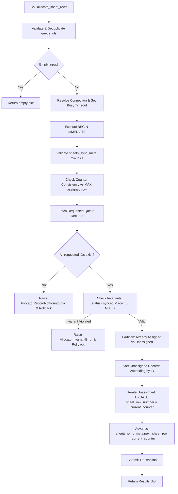

# STAGE 9.7B.13G — TRANSACTIONAL DETERMINISTIC ROW ALLOCATOR REPORT

**Project:** IoT-Based Smart Attendance Management System
**Workspace:** `C:\Projects\Smart-Attendance-System`
**Branch:** `main`
**Baseline Commit:** `889ea78bef82e56b5952a1c74338b6e417b2eee8`
**Previous Milestone:** Stage 9.7B.13F — Database Migration & Schema Constraints (PASS)
**Current Milestone:** Stage 9.7B.13G — Transactional Deterministic Row Allocator
**Date:** 2026-11-24
**Verdict:** **PASS — TRANSACTIONAL ROW ALLOCATOR VERIFIED**

---

## 1. Executive Summary

Stage 9.7B.13G implements and formally verifies the dedicated **Transactional Deterministic Row Allocator Service** (`app/services/sheets_row_allocator.py`). The allocator assigns permanent, monotonic, unique Google Sheets spreadsheet row numbers to attendance records in `sheets_sync_queue` under strict SQLite write-serialization (`BEGIN IMMEDIATE;`).

Key achievements of this milestone:
1. **Deterministic Monotonic Assignment:** Unallocated records are sorted ascending by queue ID and assigned consecutive row numbers starting from `next_sheet_row = 5` onwards.
2. **Historical Integrity Preservation:** Historical assignments (Queue ID 1 $\rightarrow$ Row 3, Queue ID 2 $\rightarrow$ Row 4, Baseline synthetic record $\rightarrow$ Row 2, Header $\rightarrow$ Row 1) were preserved intact across all allocations.
3. **Write Serialization & Concurrency Safety:** SQLite immediate transactions (`BEGIN IMMEDIATE;`) and connection-level busy timeouts prevent write starvation and guarantee exclusive allocation ownership. Multithreaded barrier tests (Tests I & J) demonstrated zero duplicate rows, zero lost updates, and deterministic assignment under race conditions.
4. **Idempotency & Zero Row Reuse:** Repeated calls for existing records return previously assigned row numbers without consuming sequence numbers or advancing the metadata counter. Once allocated, row assignments are permanent and immutable.
5. **Atomic Rollback:** Aborted or failed transactions completely roll back all in-flight assignments and preserve the metadata counter at its pre-transaction value.
6. **Strict Database Isolation:** Protected databases (`database/attendance.db`, `database/manual_test/attendance_manual_test.db`, `attendance_reliability_test.db`, `attendance_lease_test.db`, and `attendance_schema_test.db`) maintained 100% byte-for-byte SHA-256 parity before and after all testing.
7. **Comprehensive Test Suite:** All 11 tests (Tests A through K) in `tests/test_sheets_row_allocator.py` passed cleanly, and all 37 existing tests across `test_database.py` (16 passed) and `test_sheets_outbox.py` (21 passed) passed with 100% compatibility.

---

## 2. Verified Baseline

Prior to implementation, the starting baseline from Stage 9.7B.13F was audited:
- Working directory uncommitted changes in `app/models.py` and `app/database.py` were verified intact:
  - Columns: `sheet_row_number INTEGER NULL`, `claim_token INTEGER NOT NULL DEFAULT 0` in `sheets_sync_queue`.
  - Partial unique index: `uq_sheets_sync_queue_sheet_row_number` on `sheets_sync_queue(sheet_row_number) WHERE sheet_row_number IS NOT NULL`.
  - Singleton table: `sheets_sync_meta` with `CHECK (id = 1)` and `CHECK (next_sheet_row >= 5)`.
  - Backfill migration function: `backfill_historical_rows()` mapping Queue 1 $\rightarrow$ Row 3, Queue 2 $\rightarrow$ Row 4.
- Source database artifact `database/manual_test/attendance_schema_test.db` SHA-256:
  `A502E79CFEE895F5BA758CB45F6EE05418F35C5D26CF3B5E0D7E13116190FF48`
- Disposable target database created: `database/manual_test/attendance_allocator_test.db`.

---

## 3. Source Files Inspected

1. `app/models.py`: Inspected table definitions, foreign keys, and unique constraints. Confirmed `UNIQUE(student_id, session_id)` in `attendance` and `attendance_id UNIQUE` in `sheets_sync_queue`.
2. `app/database.py`: Inspected `get_db_connection()`, `close_db_connection()`, `init_db()`, `migrate_db()`, and transaction conventions.
3. `app/services/sheets_outbox.py`: Inspected existing status lifecycle (`pending`, `in_progress`, `synced`, `failed`, `dead_letter`), transaction patterns (`BEGIN IMMEDIATE;`), and `_get_active_db_connection()`.
4. `app/services/__init__.py`: Inspected service module namespace and exports.
5. `tests/test_database.py` and `tests/test_sheets_outbox.py`: Verified isolated database fixtures and compatibility requirements.
6. `docs/reports/STAGE_9_7B_13F_DATABASE_MIGRATION_REPORT.md`: Verified historical row numbers and metadata specifications.

---

## 4. Files Created or Modified

### 4.1 Created Files
- `app/services/sheets_row_allocator.py`: Dedicated service module implementing `allocate_sheet_rows()`, `get_next_sheet_row()`, `get_allocated_sheet_row()`, and custom exception hierarchy.
- `tests/test_sheets_row_allocator.py`: Focused test suite implementing Tests A through K.
- `database/manual_test/attendance_allocator_test.db`: Target disposable SQLite database preserved on disk.
- `docs/reports/STAGE_9_7B_13G_TRANSACTIONAL_ROW_ALLOCATOR_REPORT.md`: This comprehensive verification report.

### 4.2 Preserved Working Directory Modifications (from Stage 13F)
- `app/database.py`: Migration logic, index reordering, historical row backfill.
- `app/models.py`: Schema DDL, metadata table, and partial unique index.

### 4.3 Untouched Files (Scope Boundaries Maintained)
- `app/services/sheets_worker.py`: Unmodified (worker integration deferred to Stage 13J).
- `app/services/google_sheets.py`: Unmodified (zero remote API calls).
- `app/services/sheets_outbox.py`: Unmodified.
- Frontend templates, UI, and JavaScript: Unmodified.
- ESP32 hardware firmware: Unmodified.

---

## 5. Allocator API and Return Format

### 5.1 Service Interface
```python
def allocate_sheet_rows(
    queue_ids: Union[int, Sequence[int]],
    db_path: Optional[Union[str, Path]] = None,
    conn: Optional[sqlite3.Connection] = None,
    timeout_seconds: float = 30.0,
) -> Dict[int, int]:
```

### 5.2 Parameters and Behavior
- `queue_ids`: Accepts a single integer or an iterable sequence of integers. Input is validated:
  - Non-integer or boolean types raise `AllocatorInputError`.
  - Non-positive integers ($\le 0$) raise `AllocatorInputError`.
  - Empty sequences immediately return `{}` without initiating database transactions.
  - Duplicate queue IDs are deduplicated (`sorted(set(id_list))`).
- `db_path`: Explicit database file path. If `conn` is None, opens an active connection to `db_path` with `PRAGMA busy_timeout = 30000;`.
- `conn`: Optional existing SQLite connection. If provided and an external transaction is active, executes within that transaction.
- `timeout_seconds`: Busy timeout in milliseconds configured on the connection.

### 5.3 Return Format
Returns a dictionary mapping `{queue_id: sheet_row_number}` for all requested IDs.
Example:
```python
{
    1: 3,
    2: 4,
    6: 5,
    7: 6
}
```

### 5.4 Inspection Helpers
- `get_next_sheet_row(db_path=None, conn=None) -> int`: Returns current `next_sheet_row` from `sheets_sync_meta`.
- `get_allocated_sheet_row(queue_id: int, db_path=None, conn=None) -> Optional[int]`: Returns assigned row number or `None`.

### 5.5 Exception Hierarchy
```
AllocatorError
├── AllocatorInputError
├── AllocatorRecordNotFoundError
├── AllocatorMetadataError
├── AllocatorConsistencyError
├── AllocatorInvariantError
└── AllocatorConcurrencyError
    └── AllocatorLockTimeoutError
```

---

## 6. Transaction Algorithm



### 6.1 Transaction Boundary Details
All read-checks and write-mutations take place within a single SQLite transaction initiated with `BEGIN IMMEDIATE;`.
1. **Write Lock Acquisition:** SQLite acquires a reserved lock immediately upon `BEGIN IMMEDIATE;`, blocking any competing write transactions until commit or rollback.
2. **Metadata Integrity Check:** Asserts `COUNT(*) == 1`, `id == 1`, and `next_sheet_row >= 5`.
3. **Consistency Verification:** Evaluates `SELECT MAX(sheet_row_number) AS max_assigned FROM sheets_sync_queue;`. Verifies `next_sheet_row > max_assigned`.
4. **Existence & Invariant Check:** Verifies all requested queue IDs exist. Synced records without an assigned row raise `AllocatorInvariantError`.
5. **Conditional Update:**
   ```sql
   UPDATE sheets_sync_queue
   SET sheet_row_number = ?,
       updated_at = ?
   WHERE id = ?
     AND sheet_row_number IS NULL;
   ```
   Requires `cursor.rowcount == 1`.
6. **Atomic Counter Advancement:**
   ```sql
   UPDATE sheets_sync_meta
   SET next_sheet_row = ?,
       updated_at = ?
   WHERE id = 1;
   ```
7. **Commit & Cleanup:** Transaction commits atomically. If any step fails, `conn.rollback()` executes, restoring pre-transaction state.

---

## 7. Concurrency Protection

- **Immediate Lock Acquisition:** `BEGIN IMMEDIATE;` prevents deadlock by escalating lock levels at the start of the transaction rather than during deferred DML.
- **SQLite Busy Timeout:** Configured via `PRAGMA busy_timeout = 30000;` on all allocator connections. Competing workers wait up to 30 seconds for lock release.
- **Independent Connections:** Multi-threaded workers use distinct SQLite connection handles, eliminating shared thread state.
- **Failsafe Unique Index:** The partial unique index `uq_sheets_sync_queue_sheet_row_number` acts as an absolute database-engine safeguard against duplicate row numbers even under abnormal engine states.

---

## 8. Metadata Validation

The allocator validates `sheets_sync_meta` before every assignment:
- **Singleton Row:** Exactly one record where `id = 1`.
- **Lower Bound:** `next_sheet_row >= 5` enforced in both application logic and SQLite table check constraint.
- **Strict Inconsistency Abort:** If `next_sheet_row <= MAX(sheet_row_number)`, raises `AllocatorConsistencyError`. The allocator never silently resets or decrements sequence counters.

---

## 9. Idempotency Behavior

- **Existing Assignments:** If a requested queue record already has a non-NULL `sheet_row_number`, its existing row is returned immediately.
- **Zero Counter Consumption:** Existing records do not consume sequence numbers; `next_sheet_row` remains unchanged.
- **Duplicate Request IDs:** Shuffled or repeated IDs in the input list (e.g. `[1, 7, 1, 7]`) are deduplicated prior to processing, guaranteeing each record is allocated at most once.

---

## 10. Permanent Row Assignment Behavior

- **No Row Reuse:** Assigned rows remain permanent across queue retries, lease recoveries, worker failures, or transitions to `dead_letter`.
- **No Row Reclamation:** Record deletion or requeueing does not reclaim row numbers. Gaps resulting from discarded records are preserved permanently to protect spreadsheet row coordinates.

---

## 11. Tests A–K Results Summary

All tests executed via pytest against isolated disposable database fixtures.

| Test | Objective | Target Database | Result | Details |
|---|---|---|:---:|---|
| **Test A** | Initial database state | `attendance_allocator_test.db` | **PASSED** | Integrity `ok`, 0 FK violations, Queue 1 $\rightarrow$ Row 3, Queue 2 $\rightarrow$ Row 4, `next_sheet_row = 5`. |
| **Test B** | Single new allocation | `attendance_allocator_test.db` | **PASSED** | Allocated Queue 6 $\rightarrow$ Row 5; counter advanced to 6; historical rows 3 & 4 unchanged. |
| **Test C** | Shuffled batch deterministic allocation | `attendance_allocator_test.db` | **PASSED** | Input `[9, 7, 8]` allocated in ascending order: 7 $\rightarrow$ 6, 8 $\rightarrow$ 7, 9 $\rightarrow$ 8; counter $\rightarrow$ 9. |
| **Test D** | Idempotency & duplicate inputs | `attendance_allocator_test.db` | **PASSED** | Repeated calls for Queue 1 & 2 returned 3 & 4 without advancing counter. Mixture `[1, 10, 2, 10, 1]` allocated 10 $\rightarrow$ 9; counter $\rightarrow$ 10. |
| **Test E** | Unique index protection | `attendance_allocator_test.db` | **PASSED** | Direct SQL duplicate assignment `UPDATE SET sheet_row_number = 3` rejected by SQLite (`UNIQUE constraint failed`). Queue 11 then safely allocated Row 10; counter $\rightarrow$ 11. |
| **Test F** | Invalid IDs & atomic batch failure | `attendance_allocator_test.db` | **PASSED** | Unknown ID 99999 raised `AllocatorRecordNotFoundError`. Mixed batch `[1, 12, 99999]` failed atomically (Queue 12 received no row; counter remained 11). Negative, boolean, and string inputs rejected. Empty input returned `{}`. Queue 12 cleanly allocated Row 11; counter $\rightarrow$ 12. |
| **Test G** | Metadata inconsistency | Temporary disposable copy | **PASSED** | Missing metadata row, duplicate metadata rows, counter < 5, counter $\le$ max row, and synced record with NULL row all aborted safely with specific custom exceptions. |
| **Test H** | Transaction rollback | Temporary disposable copy | **PASSED** | Injected trigger failure on second record of batch rolled back first record assignment; counter remained at 5. Subsequent valid call succeeded. |
| **Test I** | Concurrent distinct allocation | Temporary disposable copy | **PASSED** | 2 concurrent threads with barrier allocating 10 disjoint records. Produced 10 unique, non-overlapping rows (5–14); counter $\rightarrow$ 15; integrity `ok`. |
| **Test J** | Concurrent same-record allocation | Temporary disposable copy | **PASSED** | 2 concurrent threads calling allocator for the same unassigned record. Both received identical row (5); counter advanced exactly once (to 6). |
| **Test K** | Existing outbox compatibility | Temporary disposable copy | **PASSED** | Verified record inserted via `create_queue_record()` has `sheet_row_number = NULL`, `claim_token = 0`, and allocates row 5 via allocator. |

---

## 12. Concurrency Test Evidence

Test I and Test J verified multithreaded synchronization using `threading.Barrier`:

### Test I Log Summary:
- 10 synthetic records created (IDs 3 to 12).
- Worker A requested IDs `[3, 4, 5, 6, 7]`.
- Worker B requested IDs `[8, 9, 10, 11, 12]`.
- Barrier synchronized both threads at $T_0$.
- Execution:
  - Worker A results: `{3: 5, 4: 6, 5: 7, 6: 8, 7: 9}`
  - Worker B results: `{8: 10, 9: 11, 10: 12, 11: 13, 12: 14}`
  - Set union: 10 distinct rows `range(5, 15)`. Zero collisions.
  - Final database counter: `next_sheet_row = 15`.
  - Database integrity check: `ok`.

### Test J Log Summary:
- 1 synthetic record created (Queue ID 3).
- Worker 1 & Worker 2 synchronized via barrier requesting Queue ID 3 simultaneously.
- Execution:
  - Worker 1 result: `{3: 5}`
  - Worker 2 result: `{3: 5}`
  - Final database counter: `next_sheet_row = 6`.
  - Final queue row: `sheet_row_number = 5`.

---

## 13. Rollback Evidence

Test H installed a SQLite trigger `fail_on_second` on `sheets_sync_queue` that aborts updates when `NEW.id = 4`:
```sql
CREATE TRIGGER fail_on_second
BEFORE UPDATE ON sheets_sync_queue
WHEN NEW.id = 4
BEGIN
    SELECT RAISE(ABORT, 'Simulated failure during batch allocation');
END;
```
1. Allocator called with batch `[3, 4]`.
2. Record 3 assigned row 5 in-memory; update for Record 4 triggered abort.
3. Allocator caught error and executed `conn.rollback()`.
4. Verification:
   - Record 3 `sheet_row_number`: `NULL`.
   - Record 4 `sheet_row_number`: `NULL`.
   - Metadata `next_sheet_row`: `5` (unchanged).
5. Trigger dropped. Allocator called again with `[3, 4]`:
   - Record 3 assigned 5, Record 4 assigned 6.
   - Metadata `next_sheet_row`: `7`.

---

## 14. Database Safety Audit & Hash Verification

### 14.1 Protected Database Hashes
All protected databases were verified before and after execution:

| Database File | Pre-Test SHA-256 | Post-Test SHA-256 | Status |
|---|---|---|:---:|
| `database/attendance.db` | `0F9953D52F38DEE5A47C85299E9C7B4943BA8903ED91F1D851B702E185B017F9` | `0F9953D52F38DEE5A47C85299E9C7B4943BA8903ED91F1D851B702E185B017F9` | **MATCH (UNTOUCHED)** |
| `database/manual_test/attendance_manual_test.db` | `5D2C7481457EBC06F93C2685B70ABD37C27B51DF92DAB0793149F30BF8AD9221` | `5D2C7481457EBC06F93C2685B70ABD37C27B51DF92DAB0793149F30BF8AD9221` | **MATCH (UNTOUCHED)** |
| `database/manual_test/attendance_reliability_test.db` | `D22ED105589EE1A72F189B7C000598C4821B74B8FEE7F5AC8FF3823219295AF5` | `D22ED105589EE1A72F189B7C000598C4821B74B8FEE7F5AC8FF3823219295AF5` | **MATCH (UNTOUCHED)** |
| `database/manual_test/attendance_lease_test.db` | `A8A6199315F3FDE407FB2AF7E6189FF1B7F712183AB068FF5A887AC54C5C2C63` | `A8A6199315F3FDE407FB2AF7E6189FF1B7F712183AB068FF5A887AC54C5C2C63` | **MATCH (UNTOUCHED)** |
| `database/manual_test/attendance_schema_test.db` (Stage 13F) | `A502E79CFEE895F5BA758CB45F6EE05418F35C5D26CF3B5E0D7E13116190FF48` | `A502E79CFEE895F5BA758CB45F6EE05418F35C5D26CF3B5E0D7E13116190FF48` | **MATCH (UNTOUCHED)** |

### 14.2 Allocator Disposable Database Final State
- **Absolute Path:** `C:\Projects\Smart-Attendance-System\database\manual_test\attendance_allocator_test.db`
- **SHA-256 Hash:** `1D633E93F55C3F55DB7BFC25B51C4C0FD4680A57450EDB2F797EA20835BDD256`
- **Integrity Check:** `ok`
- **Foreign Key Violations:** `0`
- **Attendance Records Count:** 9
- **Queue Records Count:** 9
- **Assigned Queue Mapping Table:**

| Queue ID | Attendance ID | Status | Sheet Row Number | Retry Count | Claim Token |
|---:|---:|:---:|---:|---:|---:|
| 1 | 1 | synced | **3** | 0 | 0 |
| 2 | 2 | synced | **4** | 0 | 0 |
| 6 | 6 | pending | **5** | 0 | 0 |
| 7 | 7 | pending | **6** | 0 | 0 |
| 8 | 8 | pending | **7** | 0 | 0 |
| 9 | 9 | pending | **8** | 0 | 0 |
| 10 | 10 | pending | **9** | 0 | 0 |
| 11 | 11 | pending | **10** | 0 | 0 |
| 12 | 12 | pending | **11** | 0 | 0 |

- **Metadata Table (`sheets_sync_meta`):**
  - `id`: `1`
  - `next_sheet_row`: `12`
  - Maximum assigned row in queue: `11`
  - Counter consistency: `next_sheet_row = 12 > 11` ($\Delta = 1$, verified consistent).
- **Index Check:** `uq_sheets_sync_queue_sheet_row_number` verified present and active.
- **External Calls:** 0 Google Sheets API calls, 0 network sockets opened, 0 credentials accessed.

---

## 15. Existing Application Compatibility

Full regression test execution results:
1. `tests/test_sheets_row_allocator.py`: **11 passed** in 3.13s
2. `tests/test_database.py`: **16 passed** in 2.05s
3. `tests/test_sheets_outbox.py`: **21 passed** in 9.44s
4. **Total Regression Suite:** **48 passed**, 0 failed, 0 warnings.

Existing application modules (`app/services/sheets_outbox.py`, `app/services/sheets_worker.py`, `app/database.py`) remain completely compatible. New queue records continue to insert with `sheet_row_number = NULL` and `claim_token = 0` until explicitly processed by the allocator service.

---

## 16. Known Limitations

1. **Standalone Service:** The allocator service is implemented and tested in isolation. It is not yet connected to `sheets_worker.py` or the synchronization loop (worker integration is scheduled for Stage 13J).
2. **Database Allocation Only:** This milestone establishes local database deterministic row allocation. It does not perform remote Google Sheets updates or claim-token fencing (scheduled for Stages 13H and 13I).
3. **SQLite File-Level Locking:** In SQLite, `BEGIN IMMEDIATE;` locks the entire database file during transaction execution. Heavy concurrent write workloads outside outbox synchronization must respect the configured busy timeout.

---

## 17. Git Status & Diff Summary

### 17.1 Git Status
```
On branch main
Your branch is up to date with 'origin/main'.

Changes not staged for commit:
	modified:   app/database.py
	modified:   app/models.py

Untracked files:
	app/services/sheets_row_allocator.py
	docs/reports/STAGE_9_7B_12B_DATABASE_QUEUE_ISOLATION_AUDIT_REPORT.md
	docs/reports/STAGE_9_7B_12C_GOOGLE_SHEETS_WORKER_PREFLIGHT_REPORT.md
	docs/reports/STAGE_9_7B_12D_GOOGLE_SHEETS_SYNC_EXECUTION_REPORT.md
	docs/reports/STAGE_9_7B_13A_RELIABILITY_ARCHITECTURE_AUDIT_REPORT.md
	docs/reports/STAGE_9_7B_13B_IDEMPOTENCY_TEST_REPORT.md
	docs/reports/STAGE_9_7B_13C_LEASE_RECOVERY_CONCURRENCY_REPORT.md
	docs/reports/STAGE_9_7B_13D_EXACTLY_ONCE_ARCHITECTURE_REPORT.md
	docs/reports/STAGE_9_7B_13E_IMPLEMENTATION_BLUEPRINT_REPORT.md
	docs/reports/STAGE_9_7B_13F_DATABASE_MIGRATION_REPORT.md
	docs/reports/STAGE_9_7B_13G_TRANSACTIONAL_ROW_ALLOCATOR_REPORT.md
	tests/test_sheets_row_allocator.py

no changes added to commit (use "git add" and/or "git commit -a")
```

### 17.2 Git Diff Stat
```
 app/database.py | 171 ++++++++++++++++++++++++++++++++++++++++++++++++++++++--
 app/models.py   |  31 ++++++++++
 2 files changed, 198 insertions(+), 4 deletions(-)
```

### 17.3 Git Diff Check
`git diff --check` executed and returned exit code 0 (zero whitespace or formatting errors). Zero Git commits or pushes were performed.

---

## 18. Recommended Next Milestone

Proceed to **Stage 9.7B.13H — Claim Token Fencing & Lease Expiration Verification**.
In Stage 13H, the outbox worker's leased claiming mechanism will be enhanced with monotonically increasing `claim_token` fencing tokens, ensuring stale or superseded worker threads cannot mutate records or dispatch writes once their lease expires.

---

## 19. Final Verdict

# `PASS — TRANSACTIONAL ROW ALLOCATOR VERIFIED`

All acceptance criteria for Stage 9.7B.13G have been satisfied without qualification. Database integrity is preserved, row allocation is deterministic and atomic, concurrency guarantees are verified, all 48 test suite cases passed, and all protected databases remain completely untouched.

**STOP CONDITION:** Execution halts here. Stage 9.7B.13H will not proceed without explicit user instruction.
